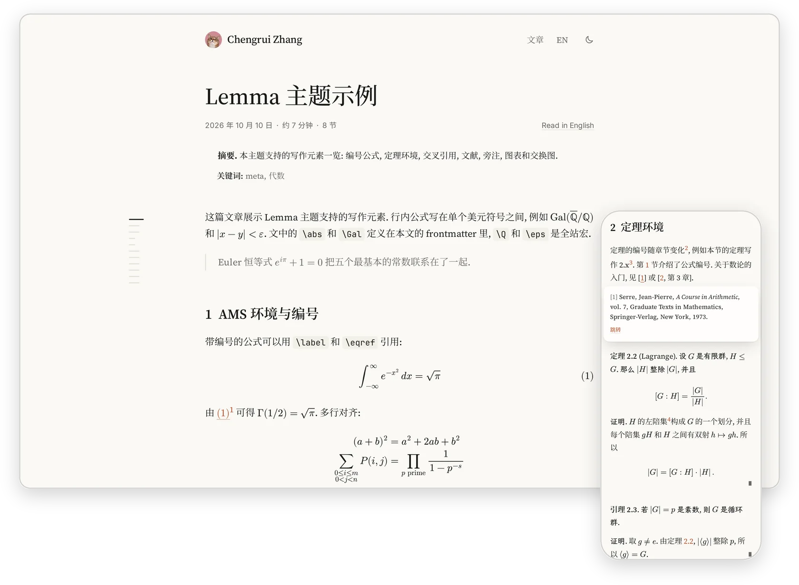
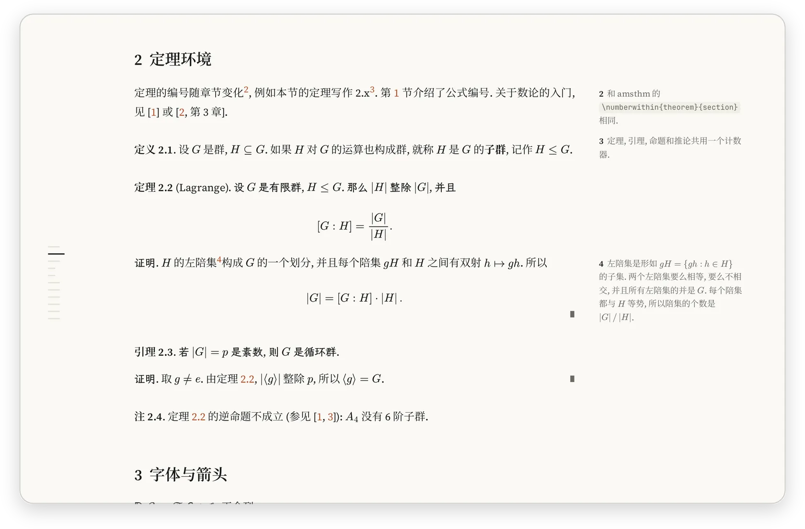
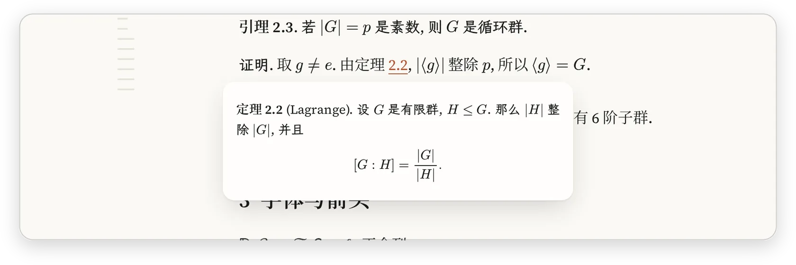
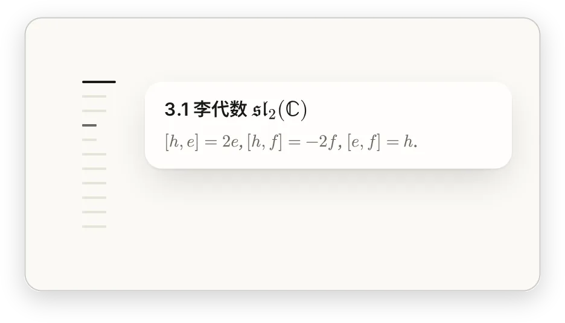
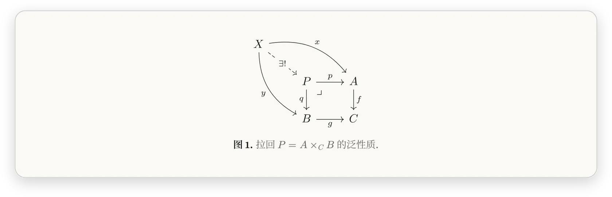
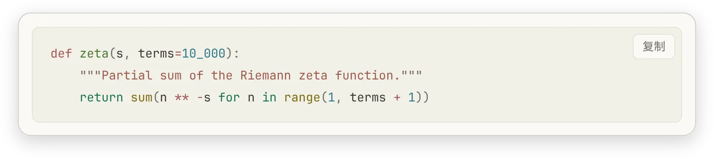

<div align="center">
  <h1>Lemma</h1>
  <p><b>A quiet Astro theme for math-heavy writing: real LaTeX, numbered theorems, citations, sidenotes and link previews, in Chinese and English.</b></p>
  <p>The theme behind <a href="https://jczhang.cc">jczhang.cc</a>, and the source of that blog.</p>
  <a href="LICENSE"></a>
  <a href="https://astro.build"></a>
  <a href="https://www.mathjax.org"></a>
  <a href="https://jczhang.cc"></a>
</div>

<p align="center">
  <picture>
    <source media="(prefers-color-scheme: dark)" srcset="docs/img/hero-dark.webp">
    
  </picture>
</p>

> 💡 This repository is a working personal blog and a theme at the same time. To use the theme, fork it, change the settings in [Make it yours](#make-it-yours), and replace the posts. The sample post `src/content/posts/hello-math/` (a draft) uses every feature.

## Features

- **Real LaTeX, rendered at build time**: MathJax 4 turns formulas into SVG, so pages ship no math JavaScript. AMS environments, `physics`, `mathtools`, `mhchem`, `cases`, blackboard and script alphabets; site-wide and per-post macros; build warnings for any TeX error or undefined macro.
- **Paper structure**: numbered sections, theorem-like environments numbered per section, proofs with ∎, `\label` / `\ref` / `\eqref` with forward references, numbered figures and tables with captions where print puts them, booktabs tables.
- **Citations from BibTeX**: `\cite{key}` becomes a numbered link and an AMS-style reference list; entries come from plain BibTeX files.
- **Read in place**: footnotes become sidenotes in the margin on wide screens; citations, cross-references and notes open a preview card on hover, focus or tap.
- **Diagrams**: `tikzcd` and `tikz` code blocks are compiled by LaTeX into inline SVG that follows the text color.
- **Bilingual**: Chinese at `/`, English at `/en/`, translations linked both ways, careful CJK typesetting (mixed-script spacing, justified Chinese).
- **Comfortable to read**: a tick-mark table of contents with section cards, light and dark themes with no flash, reading time, copy buttons, edge fades on wide content, 44px tap targets, WCAG AA contrast.
- **Static and private**: no trackers, no third-party scripts; deploys as static files.

## Quick Start

Needs [Bun](https://bun.sh) 1.2+: the `new`, `media:push` and `deploy` scripts run with it. `dev`, `build` and `preview` also run with npm on Node 22.12+. TikZ diagrams also need TeX Live (`latex`, `dvisvgm`, `tikz-cd`).

```bash
git clone https://github.com/jczhang02/lemma-blog.git && cd lemma-blog
bun install
bun run dev              # http://localhost:4321, drafts included
```

```bash
bun run new my-post      # src/content/posts/my-post/zh.md, a draft; --en for en.md
bun run build            # static site in dist/, drafts left out
bun run deploy           # build and upload to Cloudflare (see Deploying)
bun run media:push       # upload videos over 25 MiB to R2
```

## Make it yours

Every setting lives in one file, [`lemma.config.mjs`](lemma.config.mjs); the rest is theme. A running dev server picks up edits to it, re-rendering every post.

```js
export default {
  site: {
    url: 'https://jczhang.cc',
    title: 'Chengrui Zhang',
    description: { zh: '方程, 模型, 以及其他.', en: 'Equations, models, and other things.' },
    avatar: 'src/assets/avatar.jpg',
    links: { email: 'jczhang@live.it', github: 'jczhang02' },
    // ...
  },
  theme: {
    colors: { light: { bg: '#faf9f5', accent: '#b5532f', /* ... */ }, dark: { /* ... */ } },
    fonts: { stacks: { /* sans, serif, kai, mono */ }, imports: ['@fontsource-variable/inter', /* ... */], cjkImports: [/* ... */] },
    layout: { measure: '46rem', textBase: '1.125rem', leading: 1.75 },
  },
  math: { macros: { R: '\\mathbb{R}', /* ... */ }, packages: ['ams', 'physics', /* ... */] },
  // also: locales, code, bibliography, theorems, reading, media, deploy
};
```

| Section | What it sets |
| --- | --- |
| `site` | URL (canonical links, Open Graph, sitemap, RSS), name, author (also as BibTeX `Last, First`), tagline per language, avatar, footer links, icons |
| `locales` | default language and the language list (pages exist for `zh` and `en`) |
| `theme` | light and dark colors, font stacks and the font packages to load (the CJK ones go in a stylesheet of their own), text width and size; [`DESIGN.md`](DESIGN.md) describes the system |
| `code` | Shiki themes; token colors are raised to 4.5:1 against the code background |
| `math` | site-wide TeX macros and the MathJax packages loaded up front |
| `bibliography` | BibTeX files and the CSL style of the reference list |
| `theorems` | names of theorem-like environments, figures and tables, per language |
| `reading` | reading speeds behind "约 8 分钟 / 8 min read" |
| `media` | size limit for bundled videos and the R2 bucket for larger ones |
| `deploy` | Cloudflare Worker name, account ID and domain |

A few things are files by nature: the avatar image under `src/assets/`, the icons in `public/`, the posts in `src/content/posts/`, and the BibTeX files.

**Bibliography.** Cited entries live in `src/bibliography.bib`, an ordinary BibTeX file you edit by hand. `bibliography.files` can list more files (a key in several is taken from the first); any tool that writes BibTeX, such as a reference manager's export, can fill one of them.

## Writing

A post is a folder: `src/content/posts/<slug>/zh.md` and/or `en.md`, with its images and videos next to it.

```markdown
---
title: Neural operators for Burgers' equation
description: "One or two sentences, shown as the abstract. Quote it if it contains a colon."
date: 2026-10-10
tags: [PDE, operator learning]
draft: true
macros:
  Lap: '\Delta'
---

## Setting \label{sec:setting}

$$
\begin{equation}
  u_t + u u_x = \nu u_{xx} \label{eq:burgers}
\end{equation}
$$

:::theorem[Existence]{#thm:exist}
For smooth initial data, \eqref{eq:burgers} has a unique smooth solution.
:::

:::proof
See \cite{evans2010}.
:::

As Theorem \ref{thm:exist} shows in Section \ref{sec:setting}, ...[^1]

[^1]: Footnotes become sidenotes on wide screens.
```

| Element | Syntax |
| --- | --- |
| Math | `$...$`, `$$...$$`, any AMS environment; `\label`, `\eqref` |
| Sections | `## Title \label{sec:x}`; h2/h3 are numbered (`numbering: false` turns it off) |
| Theorems | `:::theorem[Name]{#thm:x}` … `:::` — also `lemma`, `proposition`, `corollary`, `definition`, `example`, `remark`, `proof` |
| References | `\ref{thm:x}`, `\ref{fig:x}`, `\ref{sec:x}`, `\eqref{eq:x}`, written in prose |
| Citations | `\cite{key}`, `\cite{a,b}`, `\cite[Thm.~3]{key}` |
| Figures, tables | `:::figure{#fig:x .invert-dark}` / `:::table{#tab:x}` around an image or table and a caption paragraph |
| Diagrams | a ` ```tikzcd ` or ` ```tikz ` code block (cached in `tikz-cache/`, commit it) |
| Video | `` |
| Footnotes | `text[^1]` and `[^1]: note` |

Write `.md`, not `.mdx`: MDX reads `{`, `}` and `<` as JSX and breaks TeX. The build prints `[mathjax]`, `[cite]`, `[theorems]`, `[tikz]` and `[media]` warnings with the file name; drafts are checked too. A longer cheat sheet, in Chinese, is in [`WRITING.md`](WRITING.md).

## Features in detail

### Sidenotes

From 1200px wide, footnotes sit in the right margin, each on the baseline of its reference; notes that would overlap stack downward, and the text shifts left when the margin is short. Narrower screens keep the notes at the end of the post, and the reference opens a preview card instead.

<picture>
  <source media="(prefers-color-scheme: dark)" srcset="docs/img/sidenotes-dark.webp">
  
</picture>

### Link previews

Citations, `\ref`, `\eqref` and notes show their target in a card: the reference entry, the full theorem statement, a figure with its caption, the equation, or a section's opening. Hover (after 200ms) or keyboard focus opens it on desktop; on touch screens the first tap opens it and the second follows the link.

<picture>
  <source media="(prefers-color-scheme: dark)" srcset="docs/img/preview-dark.webp">
  
</picture>

### Table of contents

A column of ticks in the left margin, one per section, the current one long and dark. Each tick shows its section's title and first lines on hover or focus.

<picture>
  <source media="(prefers-color-scheme: dark)" srcset="docs/img/toc-dark.webp">
  
</picture>

### Diagrams and code

TikZ diagrams use the same fonts and size as the formulas around them and switch color with the theme. Code is highlighted at build time, with a copy button.

<picture>
  <source media="(prefers-color-scheme: dark)" srcset="docs/img/diagram-dark.webp">
  
</picture>

<picture>
  <source media="(prefers-color-scheme: dark)" srcset="docs/img/code-dark.webp">
  
</picture>

<details>
<summary><strong>Deploying</strong></summary>

`bun run deploy` writes the wrangler config from `lemma.config.mjs` (`deploy`: Worker name, account ID, domain) to `.wrangler/deploy.jsonc`, builds the site, and uploads `dist/` as Cloudflare Workers static assets (no Worker code, so requests are free and unlimited). It signs in with the `cf` CLI login (`cf auth login`) when `cf` is installed, and otherwise with wrangler's own (`bunx wrangler login`). Extra arguments go to wrangler, for example `bun run deploy --dry-run`.

Any static host works too: the output in `dist/` is plain HTML, CSS and fonts. Files over 25 MiB are not accepted by Cloudflare, which is why large videos go to R2 with `bun run media:push`: it uploads them under a content hash, records them in `src/media-r2.json`, and keeps them out of git. It uploads with the `cf` CLI, so install `cf` and run `cf auth login` first.

On jczhang.cc, the R2 host has edge caching for a year (query strings ignored), a WAF rule that blocks query strings and non-GET/HEAD requests, and a rate limit of 100 requests per 10 seconds per IP, so the only metered item stays near zero.

</details>

<details>
<summary><strong>How it works</strong></summary>

Markdown goes through Astro's unified pipeline with local plugins:

- `plugins/remark-tikz.mjs`: TikZ code blocks to SVG through `latex` and `dvisvgm`, cached by content hash.
- `plugins/remark-theorems.mjs`: section and theorem numbering, figures and tables, `\label` / `\ref`.
- `plugins/remark-reading.mjs`: reading time and section count.
- `plugins/remark-cite.mjs`: `\cite` and the reference list (citation-js, AMS numeric CSL).
- `plugins/media.mjs`: video embedding, dev serving, build copy, R2 URLs.
- `plugins/rehype-mathjax4.mjs`: MathJax 4 to SVG, per-post macro sandbox, forward references.
- `plugins/rehype-toc.mjs`: TOC entries with rendered math and section previews.
- `plugins/rehype-tables.mjs`, `plugins/rehype-footnotes.mjs`: table wrappers, localized footnotes.

Client-side code is small and lives in `src/components/` (TOC, sidenotes, previews, copy buttons). `astro.config.mjs` imports the plugins with a hash of their sources, so editing a plugin re-renders every post in a running dev server.

</details>

## License

The code is [MIT](LICENSE). The posts (except the sample post `hello-math`), the avatar and the site icons are mine and not covered by it; `plugins/ams-numeric.csl` comes from the [CSL styles repository](https://github.com/citation-style-language/styles) under CC BY-SA 3.0.
