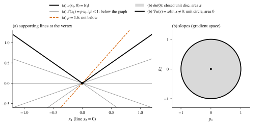
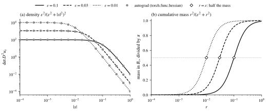
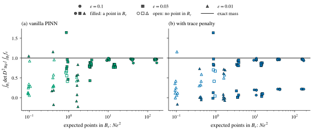
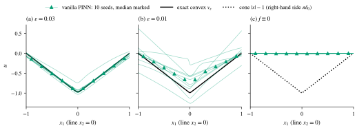

## 引言 \label{sec:intro}

[上一篇文章](/posts/mae-convexity-branch/)讨论了 Monge–Ampère 方程

$$
\begin{equation}
  \det D^2 u(\bx) = f(\bx), \qquad \bx \in \Omega \subset \R^2
\end{equation}
$$

为什么要在凸函数中找解. 那里的解都是光滑的, $\det D^2 u$ 可以逐点计算. 本文看一个最简单的不光滑的凸函数, 圆锥

$$
u(\bx) = \abs{\bx}, \qquad \bx \in \R^2 .
$$

在 $\bx \ne 0$ 处, $u$ 光滑, 沿半径方向的图像是直线, 所以 $\det D^2 u(\bx) = 0$. 在原点, $u$ 不可微, $D^2 u(0)$ 没有定义. 一方面, 圆锥在除去一点之外处处满足 $\det D^2 u = 0$, 而常数函数也满足同一个方程; 另一方面, 圆锥在顶点处显然 "弯" 了, 而常数函数一点也不弯. 那么 $\det D^2 u$ 在原点应该是什么? 答案取决于我们用哪一种 "解" 的概念. 对 Monge–Ampère 方程有两种经典的弱解: Alexandrov 解和黏性解 \cite{figalli2017, gutierrez2016}. 对同一个圆锥, 两者给出不同的回答.

本文从四个方面讨论这个问题. 第 \ref{sec:alexandrov} 节引入次梯度和 Monge–Ampère 测度, 证明圆锥的 Monge–Ampère 测度是 $\pi\delta_0$, 即圆锥是 $\det D^2 u = \pi\delta_0$ 的 Alexandrov 解. 第 \ref{sec:smooth} 节用光滑函数逼近圆锥, 说明这个点质量是怎样由一族有密度的测度集中而来的. 第 \ref{sec:viscosity} 节引入黏性解, 说明圆锥不是 $\det D^2 u = f$ 的黏性解, 不论连续函数 $f$ 取什么. 第 \ref{sec:pinn} 节回到神经网络求解器: PINN 的残差损失只在配点上逐点检验方程, 我们用实验说明它怎样对待这个点质量.

## 次梯度与 Monge–Ampère 测度 \label{sec:alexandrov}

### 次梯度

圆锥在原点没有切平面, 但有很多 "在图像下方" 的平面. 次梯度把这些平面的斜率收集起来.

:::definition[次梯度]{#def:subgradient}
设 $\Omega \subset \R^d$ 是开凸集, $u\colon \Omega \to \R$ 是凸函数, $\bx_0 \in \Omega$. $u$ 在 $\bx_0$ 处的次梯度是集合

$$
\partial u(\bx_0) = \bigl\{ \bp \in \R^d :\ u(\bx) \ge u(\bx_0) + \bp \cdot (\bx - \bx_0) \ \text{对一切}\ \bx \in \Omega \bigr\}.
$$

对 $E \subset \Omega$, 记 $\partial u(E) = \bigcup_{\bx \in E} \partial u(\bx)$.
:::

这是 \cite[Definition 1.1.1]{gutierrez2016} 和 \cite[§A.4.1]{figalli2017} 中的定义. 若 $u$ 在 $\bx$ 处可微, 则 $\partial u(\bx) = \set{\nabla u(\bx)}$ \cite[Lemma A.20]{figalli2017}. 所以次梯度推广了梯度: 在可微点处它是一个点, 在尖点处它是一个集合.

对圆锥, 在 $\bx \ne 0$ 处 $\partial u(\bx) = \set{\bx / \abs{\bx}}$, 是单位圆周上的一个点. 在原点, 条件是 $\abs{\bx} \ge \bp \cdot \bx$ 对一切 $\bx$ 成立. 若 $\abs{\bp} \le 1$, 由 Cauchy–Schwarz 不等式, $\bp \cdot \bx \le \abs{\bp}\abs{\bx} \le \abs{\bx}$; 若 $\abs{\bp} > 1$, 取 $\bx = \bp$ 得 $\abs{\bp} \ge \abs{\bp}^2$, 矛盾. 所以

$$
\partial u(0) = \set{\bp \in \R^2 : \abs{\bp} \le 1},
$$

是闭单位圆盘, 面积为 $\pi$. 图 \ref{fig:subgradient} 画出了这两种情形.

:::figure{#fig:subgradient .invert-dark}

(a) 圆锥在直线 $x_2 = 0$ 上的截面 $\abs{x_1}$ (粗黑线). 过原点的支撑平面 $\bp \cdot \bx$ ($\abs{\bp} \le 1$) 在这条直线上是 $p_1 x_1$, 都在图像下方 (灰色细实线); 斜率为 $1.6 > 1$ 的直线穿过图像 (橙色虚线). (b) 斜率空间. 原点处的次梯度是闭单位圆盘 (灰色填充), 面积为 $\pi$; 其他点的梯度 $\bx/\abs{\bx}$ 都落在单位圆周上 (粗黑线), 面积为 $0$.
:::

### Monge–Ampère 测度

对光滑凸函数, $\det D^2 u$ 是梯度映射 $\bx \mapsto \nabla u(\bx)$ 的面积缩放倍数: 若 $u \in C^2(\Omega)$ 是凸函数, 则

$$
\abs{\nabla u(E)} = \int_E \det D^2 u(\bx) \,\mathrm{d}\bx \qquad \text{对一切 Borel 集}\ E \subset \Omega,
$$

其中 $\abs{\cdot}$ 是 Lebesgue 测度 \cite[Example 1.1.14]{gutierrez2016}. 左边只用到梯度映射的像的面积, 不用二阶导数. Alexandrov 的想法是把梯度换成次梯度, 这样左边对任何凸函数都有意义.

:::definition[Monge–Ampère 测度与 Alexandrov 解]{#def:alexandrov}
设 $\Omega \subset \R^d$ 是开凸集, $u\colon \Omega \to \R$ 是凸函数. 对 Borel 集 $E \subset \Omega$, 定义

$$
\MA_u(E) = \abs{\partial u(E)} .
$$

$\MA_u$ 是 $\Omega$ 上的非负局部有限 Borel 测度, 称为 $u$ 的 Monge–Ampère 测度 \cite[Definition 2.1, Theorem 2.3]{figalli2017}. 设 $\nu$ 是 $\Omega$ 上的非负局部有限 Borel 测度. 若 $\MA_u = \nu$, 则称 $u$ 是 $\det D^2 u = \nu$ 的 Alexandrov 解 \cite[Definition 2.5]{figalli2017}. 当 $\nu = f\,\mathrm{d}\bx$, 其中 $f \ge 0$, $f \in L^1_{\mathrm{loc}}(\Omega)$ 时, 也称 $u$ 是 $\det D^2 u = f$ 的 Alexandrov 解.
:::

由上面的面积公式, 光滑凸函数的 $\MA_u$ 有密度 $\det D^2 u$. 定义 \ref{def:alexandrov} 的好处是右端 $\nu$ 可以是一般的测度, 包括点质量.

:::proposition[圆锥的 Monge–Ampère 测度]{#prop:cone}
设 $u(\bx) = \abs{\bx}$, $\Omega = \R^2$. 则 $\MA_u = \pi \delta_0$, 即圆锥是 $\det D^2 u = \pi\delta_0$ 的 Alexandrov 解.
:::

:::proof
设 $E \subset \R^2$ 是 Borel 集. 若 $0 \notin E$, 则 $E$ 中每一点的次梯度都是单位圆周上的一个点, 所以 $\partial u(E)$ 包含在单位圆周中, 面积为 $0$, 即 $\MA_u(E) = 0$. 若 $0 \in E$, 则 $\partial u(E)$ 包含闭单位圆盘 $\partial u(0)$, 又包含在单位圆盘和单位圆周的并中, 也就是闭单位圆盘本身, 所以 $\MA_u(E) = \pi$. 两种情形合起来就是 $\MA_u(E) = \pi\,\delta_0(E)$.
:::

一般地, $d$ 维的 $u = M\abs{\bx}$ 满足 $\MA_u = M^d \abs{B_1}\,\delta_0$ \cite[Example 2.2]{figalli2017}. 命题 \ref{prop:cone} 说明, 圆锥的 "弯曲" 全部集中在顶点, 总量为 $\pi$. 这个量在逐点的意义下看不到: 原点以外 $\det D^2 u = 0$, 原点本身面积为零.

这个点质量也确定了边值问题的解. 在单位圆盘 $B_1$ 上, 函数 $\abs{\bx} - 1$ 是凸的, 在 $\partial B_1$ 上为 $0$, Monge–Ampère 测度为 $\pi\delta_0$. 由 Dirichlet 问题的存在性和唯一性 \cite[Theorem 2.13, Corollary 2.11]{figalli2017}, 它是 $B_1$ 上满足 $\MA_u = \pi\delta_0$ 且边界值为 $0$ 的唯一凸函数. 同理, 满足 $\MA_u = 0$ 且边界值为 $0$ 的凸函数只有 $u \equiv 0$. 而若只要求 "$\det D^2 u = 0$ 在除去一点之外处处成立", 则对每个 $c \ge 0$, 凸函数 $c(\abs{\bx} - 1)$ 都满足要求, 边界值也都是 $0$. 所以逐点几乎处处成立不是一个合适的解的概念: 它不能确定解. 由 $\MA_{\lambda u} = \lambda^2 \MA_u$ (二维, \cite[Lemma 2.9]{figalli2017}), 这一族函数的 Monge–Ampère 测度是 $c^2 \pi \delta_0$, Alexandrov 解的定义把它们区分开了.

## 光滑逼近: 点质量从哪里来 \label{sec:smooth}

在 $\R^2$ 上取

$$
u_\varepsilon(\bx) = \sqrt{\varepsilon^2 + \abs{\bx}^2}, \qquad \varepsilon > 0 .
$$

$u_\varepsilon$ 无穷次可微, 且 $0 \le u_\varepsilon(\bx) - \abs{\bx} \le \varepsilon$, 所以 $\varepsilon \to 0$ 时 $u_\varepsilon$ 一致收敛到圆锥. 记 $s = \varepsilon^2 + x_1^2 + x_2^2$, 直接计算得 $\partial_{11} u_\varepsilon = (\varepsilon^2 + x_2^2) s^{-3/2}$, $\partial_{22} u_\varepsilon = (\varepsilon^2 + x_1^2) s^{-3/2}$, $\partial_{12} u_\varepsilon = -x_1 x_2 s^{-3/2}$, 所以

$$
\begin{equation}
  f_\varepsilon(\bx) := \det D^2 u_\varepsilon(\bx) = \frac{(\varepsilon^2 + x_2^2)(\varepsilon^2 + x_1^2) - x_1^2 x_2^2}{s^3} = \frac{\varepsilon^2}{(\varepsilon^2 + \abs{\bx}^2)^2} .
  \label{eq:feps}
\end{equation}
$$

$\partial_{11} u_\varepsilon > 0$ 且 $\det D^2 u_\varepsilon > 0$, 所以 $D^2 u_\varepsilon \succ 0$, $u_\varepsilon$ 是凸函数. 用极坐标计算 $f_\varepsilon$ 在圆盘 $B_r$ 上的积分:

$$
\int_{B_r} f_\varepsilon \,\mathrm{d}\bx = 2\pi \int_0^r \frac{\varepsilon^2 \rho}{(\varepsilon^2 + \rho^2)^2} \,\mathrm{d}\rho = \frac{\pi r^2}{\varepsilon^2 + r^2} .
$$

令 $r \to \infty$, 整个平面上的总质量为 $\pi$, 与 $\varepsilon$ 无关; 取 $r = 1$, 单位圆盘上的质量为 $\pi / (1 + \varepsilon^2)$. 取 $r = \varepsilon$ 得 $\pi/2$: 一半的质量落在半径为 $\varepsilon$ 的小圆盘里, 而这个小圆盘的面积只占单位圆盘的 $\varepsilon^2$. 另外, 密度的最大值 $f_\varepsilon(0) = \varepsilon^{-2}$ 随 $\varepsilon \to 0$ 趋于无穷. 图 \ref{fig:density} 画出了 $f_\varepsilon$ 的径向分布和累积质量.

:::figure{#fig:density .invert-dark}

(a) $f_\varepsilon = \det D^2 u_\varepsilon$ 沿半径的取值. 黑线是公式 \eqref{eq:feps}, 两个面板中实线, 虚线和点线分别对应 $\varepsilon = 0.1$, $0.03$ 和 $0.01$; 灰点是在远程服务器上用 `torch.func.hessian` 自动求导算出的值. (b) 累积质量 $r^2/(\varepsilon^2 + r^2)$; 灰色点线 $1/2$ 上的空心菱形标出 $r = \varepsilon$ 处的一半质量.
:::

于是, 质量保持不变, 并且越来越集中到原点. 精确的说法是测度的弱$^*$ 收敛. 对具有紧支集的连续函数 $\varphi$, 作替换 $\bx = \varepsilon \mathbf{y}$,

$$
\int_{\R^2} \varphi\, f_\varepsilon \,\mathrm{d}\bx = \int_{\R^2} \varphi(\varepsilon \mathbf{y})\, \frac{\mathrm{d}\mathbf{y}}{(1 + \abs{\mathbf{y}}^2)^2} \;\longrightarrow\; \varphi(0) \int_{\R^2} \frac{\mathrm{d}\mathbf{y}}{(1 + \abs{\mathbf{y}}^2)^2} = \pi\, \varphi(0),
$$

其中极限由控制收敛定理得到 (控制函数取 $\max\abs{\varphi}\,(1 + \abs{\mathbf{y}}^2)^{-2}$). 所以 $f_\varepsilon \,\mathrm{d}\bx$ 弱$^*$ 收敛到 $\pi \delta_0$. 这与 Alexandrov 解的稳定性一致.

:::proposition[Monge–Ampère 测度的稳定性]{#prop:stability}
(\cite[Proposition 2.6]{figalli2017}) 设凸函数 $u_k$ 在开集 $\Omega$ 上局部一致收敛到凸函数 $u$. 则 $\MA_{u_k}$ 弱$^*$ 收敛到 $\MA_u$, 即 $\int_\Omega \varphi \,\mathrm{d}\MA_{u_k} \to \int_\Omega \varphi \,\mathrm{d}\MA_u$ 对一切 $\varphi \in C_c(\Omega)$ 成立.
:::

由命题 \ref{prop:cone} 和命题 \ref{prop:stability}, 不做上面的计算也能知道极限是 $\pi\delta_0$. 需要注意, 弱$^*$ 收敛不是在每个集合上收敛: $\MA_{u_\varepsilon}(\set{0}) = 0$, 因为 $\MA_{u_\varepsilon}$ 有密度, 单点的面积为零; 而 $\MA_u(\set{0}) = \pi$. 这正是数值方法需要注意的地方: 近似解的 Hessian 行列式在每一点都是有限的, 质量却可以集中到一个越来越小的区域里.

## 黏性解: 用光滑函数接触 \label{sec:viscosity}

第二种弱解来自完全非线性方程的一般理论 \cite{crandall1992}. $u$ 本身没有二阶导数, 就用光滑的检验函数从上方或下方贴住 $u$, 让检验函数代替 $u$ 接受方程的检验.

:::definition[黏性解]{#def:viscosity}
(\cite[Definition 1.3.1]{gutierrez2016}) 设 $u \in C(\Omega)$ 是凸函数, $f \in C(\Omega)$, $f \ge 0$. 若对任意凸函数 $\varphi \in C^2(\Omega)$ 和 $\bx_0 \in \Omega$, 只要 $u - \varphi$ 在 $\bx_0$ 取局部极大值, 就有 $\det D^2 \varphi(\bx_0) \ge f(\bx_0)$, 则称 $u$ 是 $\det D^2 u = f$ 的黏性下解. 若只要 $u - \varphi$ 在 $\bx_0$ 取局部极小值, 就有 $\det D^2 \varphi(\bx_0) \le f(\bx_0)$, 则称 $u$ 是黏性上解. 既是下解又是上解的 $u$ 称为黏性解.
:::

定义中的二阶导数都是 $\varphi$ 的, 所以对不可微的 $u$ 也有意义. 对光滑的凸解, 这两个条件都成立: 若 $\varphi$ 从上方接触 $u$, 则 $D^2 \varphi(\bx_0) \succeq D^2 u(\bx_0) \succeq 0$, 由行列式在半正定矩阵上的单调性, $\det D^2 \varphi(\bx_0) \ge \det D^2 u(\bx_0)$; 从下方接触的情形同理. 黏性解就是把这两个必要条件反过来作为定义. 另外, 定义要比较 $\det D^2\varphi(\bx_0)$ 和 $f(\bx_0)$, 所以 $f$ 在每一点的值必须有意义, 这里要求 $f$ 连续. 点质量 $\pi\delta_0$ 不是函数, 所以 "$\det D^2 u = \pi\delta_0$ 的黏性解" 这个说法本身没有意义.

:::proposition[圆锥不是黏性解]{#prop:cone-visc}
设 $u(\bx) = \abs{\bx}$, $\Omega = \R^2$.

1. 对任意 $f \in C(\R^2)$, $f \ge 0$, $u$ 不是 $\det D^2 u = f$ 的黏性上解.
2. 若 $f(\bx_0) > 0$ 对某个 $\bx_0 \ne 0$ 成立, 则 $u$ 不是 $\det D^2 u = f$ 的黏性下解. 特别地, $u$ 既不是 $\det D^2 u = 1$ 的黏性下解, 也不是黏性上解.
:::

:::proof
(1) 对 $c > 0$, 凸函数 $\psi(\bx) = c\abs{\bx}^2$ 满足: 当 $\abs{\bx} \le 1/c$ 时, $(u - \psi)(\bx) = \abs{\bx}(1 - c\abs{\bx}) \ge 0 = (u - \psi)(0)$, 即 $u - \psi$ 在原点取局部极小值. 但 $\det D^2 \psi = 4c^2$, 取 $c$ 足够大时它大于 $f(0)$, 违反上解条件.

(2) 记 $r = \abs{\bx_0}$, $\mathbf{e} = \bx_0 / r$, $\mathbf{e}^\perp$ 为与 $\mathbf{e}$ 垂直的单位向量. 在 $\bx_0$ 附近 $u$ 光滑, $\nabla u(\bx_0) = \mathbf{e}$, $D^2 u(\bx_0) = \tfrac{1}{r}\mathbf{e}^\perp \mathbf{e}^{\perp\top}$. 对 $\delta > 0$, 令

$$
\varphi(\bx) = r + \mathbf{e}\cdot(\bx - \bx_0) + \tfrac{\delta}{2}\bigl(\mathbf{e}\cdot(\bx - \bx_0)\bigr)^2 + \tfrac12\bigl(\tfrac1r + \delta\bigr)\bigl(\mathbf{e}^\perp\cdot(\bx - \bx_0)\bigr)^2 .
$$

$\varphi$ 是凸的二次多项式, $\varphi(\bx_0) = u(\bx_0)$, $\nabla\varphi(\bx_0) = \nabla u(\bx_0)$, $D^2(\varphi - u)(\bx_0) = \delta I \succ 0$, 所以 $u - \varphi$ 在 $\bx_0$ 取局部极大值. 但 $\det D^2 \varphi(\bx_0) = \delta(\tfrac1r + \delta)$, 取 $\delta$ 足够小时它小于 $f(\bx_0)$, 违反下解条件.
:::

(1) 说明, 黏性解在顶点处看到了圆锥的弯曲: 从下方接触圆锥的检验函数可以任意弯, 它的 Hessian 行列式没有上界, 任何有限的 $f(0)$ 都不够. 反过来, 圆锥是 $\det D^2 u = 0$ 的黏性下解. 在 $\bx_0 \ne 0$ 处, 凸的检验函数满足 $\det D^2\varphi(\bx_0) \ge 0$; 在原点, 没有 $C^2$ 函数能从上方接触圆锥: 若 $u - \varphi$ 在原点取局部极大值, 则 $\varphi(t\mathbf{e}) - \varphi(0) \ge \abs{t}$ 对任意单位向量 $\mathbf{e}$ 和小的 $t$ 成立, 令 $t \to 0^\pm$ 得 $\nabla\varphi(0)\cdot\mathbf{e} \ge 1$ 和 $-\nabla\varphi(0)\cdot\mathbf{e} \ge 1$, 矛盾. 所以对 $\det D^2 u = 0$, 圆锥满足下解条件而不满足上解条件: 它 "弯得太多".

## PINN 看到了什么 \label{sec:pinn}

PINN 用网络 $u_\theta$ 表示解, 在区域内部的配点 $\bx_i$ 和边界上的配点 $\bx_k^b$ 上最小化

$$
\begin{align*}
  \mathcal{L}(\theta) &= \frac{1}{N} \sum_{i=1}^{N} \bigl( \det D^2 u_\theta(\bx_i) - f(\bx_i) \bigr)^2 + \frac{w_{bc}}{M} \sum_{k=1}^{M} u_\theta(\bx_k^b)^2 .
\end{align*}
$$

损失只用到 $f$ 在配点上的值, 所以它检验的是第 \ref{sec:alexandrov} 节末尾所说的逐点意义. 对右端 $\pi\delta_0$, 这个损失无法直接写出, 因为 $\delta_0$ 在原点没有函数值; 若只用它在原点以外的值 $0$, 由于配点以概率 $1$ 不落在原点, 损失中的 $f$ 就是 $f \equiv 0$. 能写出来的是光滑化的问题

$$
\det D^2 u = f_\varepsilon \quad \text{in } B_1, \qquad u = 0 \quad \text{on } \partial B_1,
$$

其中 $f_\varepsilon$ 由 \eqref{eq:feps} 给出. 它唯一的凸解是 $v_\varepsilon(\bx) = \sqrt{\varepsilon^2 + \abs{\bx}^2} - \sqrt{\varepsilon^2 + 1}$, 而 $-v_\varepsilon$ 是一个凹解. $\varepsilon \to 0$ 时, $f_\varepsilon \,\mathrm{d}\bx$ 弱$^*$ 收敛到 $\pi\delta_0$, $v_\varepsilon$ 一致收敛到 $\abs{\bx} - 1$. 我们想知道, 随着 $\varepsilon$ 变小, 逐点残差还能不能看到这个质量. 所有实验都在远程服务器上运行, 代码和原始结果见 [TODO: 代码仓库链接].

### 配点看到了多少质量

先不训练网络, 只看配点. 在单位圆盘中均匀采 $N$ 个点, 用 $\pi \cdot \frac1N \sum_i f_\varepsilon(\bx_i)$ 估计总质量 $\int_{B_1} f_\varepsilon = \pi/(1+\varepsilon^2)$. 这个 Monte Carlo 估计是无偏的, 但它的方差由 $\int_{B_1} f_\varepsilon^2 \,\mathrm{d}\bx = \frac{\pi}{3\varepsilon^2}\bigl(1 - \frac{\varepsilon^6}{(1+\varepsilon^2)^3}\bigr)$ 决定, 随 $\varepsilon \to 0$ 趋于无穷. 约一半的质量落在 $B_\varepsilon$ 中, 而落入 $B_\varepsilon$ 的点数的期望只有 $N\varepsilon^2$, 一个点也不落入的概率是 $(1 - \varepsilon^2)^N$. 表 \ref{tab:sampling} 是 $1000$ 组随机种子的统计.

:::table{#tab:sampling}
| $\varepsilon$ | $N$ | $N\varepsilon^2$ | 无点落入 $B_\varepsilon$ 的比例 | $(1-\varepsilon^2)^N$ | 质量估计的中位数 | 10% 与 90% 分位数 | 精确值 |
| --: | --: | --: | --: | --: | --: | --: | --: |
| $0.1$ | $1000$ | $10$ | $0$ | $4.3\times10^{-5}$ | $3.07$ | $2.38$, $3.86$ | $3.110$ |
| $0.1$ | $4000$ | $40$ | $0$ | $3.5\times10^{-18}$ | $3.09$ | $2.74$, $3.47$ | $3.110$ |
| $0.1$ | $16000$ | $160$ | $0$ | $1.5\times10^{-70}$ | $3.10$ | $2.92$, $3.30$ | $3.110$ |
| $0.03$ | $1000$ | $0.9$ | $0.421$ | $0.406$ | $2.76$ | $1.07$, $5.64$ | $3.139$ |
| $0.03$ | $4000$ | $3.6$ | $0.038$ | $0.027$ | $2.98$ | $2.00$, $4.47$ | $3.139$ |
| $0.03$ | $16000$ | $14.4$ | $0$ | $5.5\times10^{-7}$ | $3.11$ | $2.51$, $3.75$ | $3.139$ |
| $0.01$ | $1000$ | $0.1$ | $0.904$ | $0.905$ | $0.88$ | $0.18$, $9.23$ | $3.141$ |
| $0.01$ | $4000$ | $0.4$ | $0.673$ | $0.670$ | $2.06$ | $0.61$, $7.03$ | $3.141$ |
| $0.01$ | $16000$ | $1.6$ | $0.213$ | $0.202$ | $2.95$ | $1.35$, $4.81$ | $3.141$ |

均匀配点对 $f_\varepsilon$ 的总质量 $\int_{B_1} f_\varepsilon$ 的 Monte Carlo 估计, 每行 $1000$ 组随机种子. 第 4 列是实测比例, 第 5 列是理论值.
:::

$\varepsilon = 0.01$, $N = 1000$ 时, $90\%$ 的点集没有一个点落入 $B_\varepsilon$, 质量估计的中位数是 $0.88$, 不到精确值的三分之一; 另一方面, $10\%$ 的点集给出大于 $9.2$ 的估计, 因为一个落在原点附近的点就带来 $f_\varepsilon \approx \varepsilon^{-2} = 10^4$ 量级的值. $1000$ 组的平均值是 $3.14$, 符合无偏性, 但单次采样几乎总是偏离很远. 所以, 平均而言逐点残差能看到点质量; 问题在于多数点集完全错过它, 少数点集在一两个点上看到一个极大的值. 网络训练时用的是其中一个点集.

### 训练设置

网络是 MLP $2 \to 32 \to 32 \to 1$, 激活函数为 tanh, 用 `float64` 计算, 与上一篇相同. 内部配点在训练前采一次并固定, 共 $N \in \set{1000, 4000, 16000}$ 个; 采样方式与表 \ref{tab:sampling} 相同, 随机种子为 $0$ 到 $9$, 所以同一个种子在不同的 $\varepsilon$ 下用的是同一组点. 边界上取 $M = 200$ 个等距点, $w_{bc} = 10$. 优化器为 Adam, 学习率 $10^{-3}$, 全批量训练 $5000$ 步. Hessian 用 `torch.func.hessian` 精确计算. 取 $\varepsilon \in \set{0.1, 0.03, 0.01}$, 另外取 $f \equiv 0$, 它就是逐点残差对右端 $\pi\delta_0$ 的理解. 全部 $24$ 种设置 (含下面的迹罚项) 在同一块 A100 上并行运行, 每个种子用时 $122$ 到 $236$ 秒.

训练后, 在 $20000$ 个新的随机点 (随机种子 $12345$) 和直线 $x_2 = 0$ 上的 $801$ 个点 (含原点) 上测试. 由于上一篇说明的分支问题, 网络可能落到凸解 $v_\varepsilon$ 或凹解 $-v_\varepsilon$ 上, 我们用

$$
e = \min\bigl( \max\abs{u_\theta - v_\varepsilon},\ \max\abs{u_\theta + v_\varepsilon} \bigr)
$$

作为误差. 对普通 PINN, 每种 $\varepsilon > 0$ 的设置中都有 $6$ 个种子更接近凸解, $4$ 个更接近凹解. 另外, 我们用极坐标求积 (半径方向在 $[0, 1]$ 上分成 $8$ 段, 分段点为 $0, 10^{-4}, 10^{-3}, 3\times10^{-3}, 10^{-2}, 3\times10^{-2}, 0.1, 0.3, 1$, 每段 $16$ 个 Gauss–Legendre 节点, 角度方向 $64$ 个等距节点) 计算网络 "捕获的质量" $\int_{B_1} \det D^2 u_\theta \,\mathrm{d}\bx$, 与 $\int_{B_1} f_\varepsilon = \pi/(1+\varepsilon^2)$ 比较. 这个量不依赖于分支, 因为二维时 $\det D^2(-u) = \det D^2 u$.

### 结果

:::table{#tab:pinn}
| $\varepsilon$ | $N$ | $N\varepsilon^2$ | 有点落入 $B_\varepsilon$ 的种子数 | 最终损失 | 捕获的质量 | 精确质量 | 误差 $e$ |
| --: | --: | --: | --: | --: | --: | --: | --: |
| $0.1$ | $1000$ | $10$ | $10$ | $3.3\times10^{-2}$ | $2.97$ $[2.92, 3.10]$ | $3.110$ | $0.041$ $[0.014, 0.074]$ |
| $0.1$ | $4000$ | $40$ | $10$ | $3.6\times10^{-2}$ | $3.02$ $[2.72, 3.06]$ | $3.110$ | $0.037$ $[0.022, 0.101]$ |
| $0.1$ | $16000$ | $160$ | $10$ | $3.0\times10^{-2}$ | $3.01$ $[2.74, 3.05]$ | $3.110$ | $0.041$ $[0.022, 0.101]$ |
| $0.03$ | $1000$ | $0.9$ | $6$ | $1.4\times10^{-1}$ | $2.20$ $[1.29, 5.17]$ | $3.139$ | $0.150$ $[0.056, 0.341]$ |
| $0.03$ | $4000$ | $3.6$ | $10$ | $1.1$ | $2.56$ $[1.35, 2.99]$ | $3.139$ | $0.133$ $[0.100, 0.293]$ |
| $0.03$ | $16000$ | $14.4$ | $10$ | $1.9$ | $2.50$ $[2.40, 2.64]$ | $3.139$ | $0.140$ $[0.100, 0.214]$ |
| $0.01$ | $1000$ | $0.1$ | $1$ | $1.9\times10^{-2}$ | $0.83$ $[0.19, 3.30]$ | $3.141$ | $0.542$ $[0.132, 1.202]$ |
| $0.01$ | $4000$ | $0.4$ | $4$ | $3.2$ | $0.94$ $[-0.55, 3.64]$ | $3.141$ | $0.416$ $[0.160, 1.011]$ |
| $0.01$ | $16000$ | $1.6$ | $8$ | $9.3$ | $1.36$ $[-0.71, 2.62]$ | $3.141$ | $0.264$ $[0.098, 0.906]$ |
| $f \equiv 0$ | $1000$ | | $0$ | $1.8\times10^{-7}$ | $0.00$ | ($\pi\delta_0$: $\pi$) | $0.993$ $[0.990, 0.997]$ |
| $f \equiv 0$ | $4000$ | | $0$ | $1.7\times10^{-7}$ | $0.00$ | ($\pi\delta_0$: $\pi$) | $0.993$ $[0.990, 0.998]$ |
| $f \equiv 0$ | $16000$ | | $0$ | $1.8\times10^{-7}$ | $0.00$ | ($\pi\delta_0$: $\pi$) | $0.993$ $[0.990, 0.998]$ |

普通 PINN (不加迹罚项) 的结果, 每行 $10$ 个种子. 最终损失是中位数; 捕获的质量和误差给出中位数, 方括号内是最小值和最大值. $f \equiv 0$ 的误差 $e$ 是相对于圆锥 $\abs{\bx} - 1$ 及其反号计算的.
:::

:::figure{#fig:pinn-mass .invert-dark}

网络捕获的质量 $\int_{B_1} \det D^2 u_\theta$ 除以精确质量 (黑线为 $1$). 每个标记是一次训练, 每组 $(\varepsilon, N)$ 有 $10$ 个种子; 为了看清, 横坐标加了小的随机偏移. 圆形: $\varepsilon = 0.1$; 方形: $\varepsilon = 0.03$; 三角形: $\varepsilon = 0.01$. 实心: 该种子的点集中至少有一个点落入 $B_\varepsilon$; 空心: 没有. (a) 普通 PINN (绿色). (b) 加上上一篇用过的迹罚项 (蓝色).
:::

:::figure{#fig:pinn-profiles .invert-dark}

$N = 4000$ 时普通 PINN 的 $u_\theta$. 每条绿色细线是一个种子, 共 $10$ 个; 绿色三角形标出它们的中位数. 更接近凹解的结果乘以 $-1$ 后画出. (a) $\varepsilon = 0.03$. (b) $\varepsilon = 0.01$. (a) 和 (b) 中的黑色实线是精确的凸解 $v_\varepsilon$. (c) $f \equiv 0$, 黑色点线是右端为 $\pi\delta_0$ 时的唯一凸解 $\abs{\bx} - 1$.
:::

表 \ref{tab:pinn}, 图 \ref{fig:pinn-mass} 和图 \ref{fig:pinn-profiles} 给出了结果. 我们注意到三点.

一是 $f \equiv 0$ 时, 三种 $N$ 下的 $30$ 次训练都得到 $\max\abs{u_\theta} \le 0.011$ (加迹罚项的 $30$ 次不超过 $0.012$), 最终损失不超过 $2.6 \times 10^{-4}$, 而 $\max\abs{u_\theta - (\abs{\bx} - 1)}$ 在 $0.990$ 和 $1.010$ 之间. 网络找到的是 $u \equiv 0$, 即 $\MA_u = 0$ 且边界值为 $0$ 的 Alexandrov 解, 而不是右端为 $\pi\delta_0$ 的圆锥. 只看损失, 这些训练都是成功的.

二是 $\varepsilon = 0.01$, $N = 1000$ 时, 只有种子 $8$ 的点集有一个点落入 $B_\varepsilon$. 其余 $9$ 个种子的最终损失在 $0.0020$ 和 $0.18$ 之间, 和 $\varepsilon = 0.1$, $N = 1000$ 时的损失 ($0.011$ 到 $0.083$) 处于同一量级, 但捕获的质量只有 $0.19$ 到 $2.91$, 误差 $e$ 在 $0.13$ 和 $0.74$ 之间. 损失最小的种子 $3$ ($0.0020$) 捕获的质量最少 ($0.19$), 误差也最大 ($0.74$). 唯一有点落入的种子 $8$ 则是另一种失败: 损失为 $13.1$, 误差为 $1.20$. 所以在这个设置下, 损失的大小不能说明解的好坏.

三是增大 $N$ 有帮助, 但帮助有限. $\varepsilon = 0.01$ 时, $N$ 从 $1000$ 增加到 $16000$, 有点落入 $B_\varepsilon$ 的种子从 $1$ 个增加到 $8$ 个, 捕获质量的中位数从 $0.83$ 增加到 $1.36$, 误差的中位数从 $0.54$ 降到 $0.26$; 同时损失的中位数从 $0.019$ 增加到 $9.3$: 落入的那几个点上 $f_\varepsilon$ 的值很大, 网络拟合不了, 训练变得不稳定, 有的种子捕获的质量甚至是负的 (网络在一部分区域上 $\det D^2 u_\theta < 0$, 既不凸也不凹). 另外, $\varepsilon = 0.03$, $N = 16000$ 时每个种子都有 $11$ 到 $20$ 个点落入 $B_\varepsilon$, 捕获的质量仍只有精确值的 $76\%$ 到 $84\%$ ($2.40$ 到 $2.64$), 损失在 $1.1$ 和 $3.0$ 之间. 这说明除了采样, 还有第二个原因: 这个小网络在 $5000$ 步内拟合不了宽度为 $0.03$, 高度为 $\varepsilon^{-2} \approx 1111$ 的峰. 我们没有试更大的网络, 更长的训练或自适应采样, 所以不能说这个原因有多大.

加上迹罚项后, 结论没有变化 (图 \ref{fig:pinn-mass} (b)). $\varepsilon = 0.1$ 时, 它压住了凹分支, 但不能保证得到凸解: 每种 $N$ 下都有 $4$ 个种子 (种子 $0$, $6$, $7$, $8$, 正是普通 PINN 落到凹解的那几个) 停在损失大于 $1$ 的状态, 捕获的质量只有 $0.20$ 到 $0.67$, $u_\theta(0)$ 在 $0.43$ 和 $0.65$ 之间, 既不接近凸解的 $v_\varepsilon(0) \approx -0.905$, 也不接近凹解的 $0.905$.

## 小结 \label{sec:summary}

两种弱解对右端的要求不同, 下面的定理说明它们在什么时候一致.

:::theorem[Alexandrov 解与黏性解]{#thm:equiv}
设 $\Omega \subset \R^d$ 是开凸集, $u \in C(\Omega)$ 是凸函数.

1. (\cite[Proposition 1.3.4]{gutierrez2016}) 设 $f \in C(\Omega)$, $f \ge 0$. 若 $u$ 是 $\det D^2 u = f$ 的 Alexandrov 解, 则 $u$ 是 $\det D^2 u = f$ 的黏性解.
2. (\cite[Proposition 1.7.1]{gutierrez2016}) 设 $f \in C(\overline{\Omega})$, 且在 $\overline{\Omega}$ 上 $f > 0$. 若 $u$ 是 $\det D^2 u = f$ 在 $\Omega$ 中的黏性解, 则 $u$ 是 $\det D^2 u = f$ 在 $\Omega$ 中的 Alexandrov 解.
:::

两个方向的假设不同: (1) 只要 $f$ 连续, (2) 还要求 $f$ 在闭区域上为正. 两者都要求右端是连续函数, 从而 $\MA_u = f\,\mathrm{d}\bx$ 关于 Lebesgue 测度绝对连续. 圆锥两边都不满足: $\MA_u = \pi\delta_0$ 给零测集 $\set{0}$ 正的质量, 不是任何 $f\,\mathrm{d}\bx$ ($f \in L^1_{\mathrm{loc}}$) 的形式, 所以定理不适用; 命题 \ref{prop:cone-visc} 也说明, 它不是任何连续右端的黏性解. 表 \ref{tab:notions} 把三种意义下的回答放在一起.

:::table{#tab:notions}
| 解的概念 | 方程成立的意义 | 圆锥 $\abs{\bx}$ |
| :-- | :-- | :-- |
| 逐点 (几乎处处) | $\det D^2 u(\bx) = f(\bx)$ 对几乎每个 $\bx$ 成立 | 满足 $\det D^2 u = 0$; 但 $c(\abs{\bx}-1)$ ($c \ge 0$) 和常数也满足, 解不唯一 |
| Alexandrov | $\MA_u(E) = \nu(E)$ 对一切 Borel 集 $E$ 成立 | 是 $\det D^2 u = \pi\delta_0$ 的解; 在 $B_1$ 上给定边界值后唯一 |
| 黏性 | 凸的 $C^2$ 检验函数在接触点满足不等式, $f$ 连续 | 不是任何连续 $f$ 的解; 是 $\det D^2 u = 0$ 的下解, 不是上解 |

同一个函数在三种意义下的回答.
:::

PINN 的残差损失检验的是表 \ref{tab:notions} 的第一行. 我们的实验说明了这一点的后果: $f \equiv 0$ 时, 网络在 $60$ 次训练中都收敛到 $u \equiv 0$, 损失很小, 与圆锥的距离约为 $1$; 光滑化的右端 $f_\varepsilon$ 在 $\varepsilon = 0.01$, $N \le 4000$ 时, 多数均匀点集没有一个点落入 $B_\varepsilon$, 看不到那里约一半的质量, 损失小的解反而可能更差. 这些实验只用了一个小网络, 固定的均匀配点和 $5000$ 步 Adam, 我们也没有区分采样和网络表达能力各自的影响. 对右端带点质量或接近点质量的问题, 一个自然的方向是让损失直接比较测度, 例如像 Alexandrov 解的定义那样比较梯度映射的像的面积, 或者在原点附近加密配点. 这是后面的文章要讨论的问题.
