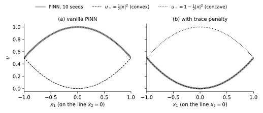

## Introduction \label{sec:intro}

For the Poisson equation $\Delta u = f$ on a bounded domain, a Dirichlet boundary condition determines the solution uniquely. The Monge–Ampère equation

$$
\begin{equation}
  \det D^2 u(\bx) = f(\bx), \qquad \bx \in \Omega,
  \label{eq:mae}
\end{equation}
$$

looks like another second-order elliptic equation, but it does not behave like one. On the one hand, $\det$ only sees the product of the eigenvalues of the Hessian, not their signs, so the equation together with the boundary condition does not determine the solution. On the other hand, the classical theory \cite{figalli2017} looks for solutions only among convex functions, and in this class the solution is unique. This has a direct consequence for numerical methods: the loss of a physics-informed neural network (PINN) usually contains only the residual and the boundary term, and the loss itself knows nothing about convexity.

The rest of this post is organized as follows. Section \ref{sec:example} gives an example with two solutions. Section \ref{sec:why} explains why convexity is the condition that selects the solution: it gives uniqueness, and it gives ellipticity. Section \ref{sec:pinn} reports a small experiment in which a vanilla PINN does converge to the wrong solution, with a small loss.

## An example with two solutions \label{sec:example}

:::example[Problem 1]{#ex:branches}
On the unit disk $\Omega = B_1 \subset \R^2$, consider

$$
\det D^2 u = 1 \quad \text{in } B_1, \qquad u = \tfrac12 \quad \text{on } \partial B_1 .
$$

The functions

$$
u_+(\bx) = \tfrac12 \abs{\bx}^2, \qquad u_-(\bx) = 1 - \tfrac12 \abs{\bx}^2
$$

have Hessians $I$ and $-I$, both with determinant $1$, and both equal $\tfrac12$ on the unit circle. So both are solutions. $u_+$ is a bowl and is convex; $u_-$ is an upside-down bowl and is concave.
:::

This is not an accident. In two dimensions, $\det D^2 u = f > 0$ says that the eigenvalues $\lambda_1, \lambda_2$ have a positive product, so they have the same sign: either both are positive ($u$ bends upward in every direction) or both are negative ($u$ bends downward in every direction). The equation cannot tell the two cases apart. Since $\det D^2(-u) = (-1)^2 \det D^2 u$, if $u$ solves the equation, so does $-u$; when the boundary value is a constant, adding a constant restores the boundary condition. This is how $u_- = 1 - u_+$ in Example \ref{ex:branches} arises.

In three or more dimensions there are more possibilities. A symmetric matrix with eigenvalues $(5, -1, -1)$ has determinant $5 > 0$, but it is neither positive nor negative semidefinite. So the equation $\det D^2 u = f$ alone cannot decide in which direction $u$ bends along each axis.

## Why convexity selects the solution \label{sec:why}

The standard approach is to look for solutions only among convex functions. A $C^2$ function on a convex domain is convex if and only if $D^2 u \succeq 0$ everywhere, that is, it bends upward in every direction. This condition does two things: it gives uniqueness, and it gives ellipticity.

### Uniqueness

:::theorem[Convex solutions of the Dirichlet problem]{#thm:dirichlet}
(\cite[Theorem 2.14]{figalli2017}) Let $\Omega \subset \R^d$ be a bounded, strictly convex domain, $f \ge 0$ with $f \in L^1(\Omega)$, and $g \in C(\partial\Omega)$. Then there is a unique function $u \in C(\overline{\Omega})$ that is convex in $\Omega$, solves $\det D^2 u = f$ in the Alexandrov sense, and satisfies $u = g$ on $\partial\Omega$.
:::

The disk is strictly convex, so among convex functions Example \ref{ex:branches} has only the solution $u_+$. Uniqueness comes from the comparison principle: if two convex functions satisfy $u \le v$ on the boundary and $\det D^2 u \ge \det D^2 v$ inside, then $u \le v$ in the whole domain \cite[§2.4]{figalli2017}. Behind the comparison principle is the monotonicity of the determinant on positive semidefinite matrices: $M \succeq N \succeq 0$ implies $\det M \ge \det N$. Outside this cone the monotonicity fails. For example, $-I \succeq -2I$, but in two dimensions $\det(-I) = 1 < 4 = \det(-2I)$.

### Ellipticity

The literature often says that the Monge–Ampère equation "is elliptic on convex functions". The linearization makes this statement precise. For $u, v \in C^2(\Omega)$, the derivative of the determinant (Jacobi's formula)

$$
\frac{\mathrm{d}}{\mathrm{d}\varepsilon}\Big|_{\varepsilon=0} \det(A + \varepsilon B) = \tr\bigl(\cof(A)^{\top} B\bigr),
$$

where $\cof A$ denotes the cofactor matrix of $A$, gives the linearization of the equation at $u$:

$$
\begin{equation}
  L_u v := \frac{\mathrm{d}}{\mathrm{d}t}\Big|_{t=0} \det D^2(u + tv) = \tr\bigl(\cof(D^2 u)\, D^2 v\bigr).
  \label{eq:linearized}
\end{equation}
$$

This is a linear second-order operator with coefficient matrix $\cof(D^2 u)$. It is elliptic at $\bx$ if and only if $\cof(D^2 u(\bx)) \succ 0$.

:::proposition[Convexity and ellipticity of the linearization]{#prop:elliptic}
Let $u \in C^2(\Omega)$.

1. If $D^2 u(\bx) \succ 0$ with eigenvalues $\lambda_1, \dots, \lambda_d$, then $\cof(D^2 u(\bx))$ has eigenvalues $\prod_{j \ne i} \lambda_j > 0$, so $L_u$ is elliptic at $\bx$.
2. If there is $C \ge 1$ such that $C^{-1} I \preceq D^2 u \preceq C I$ in $\Omega$, then $L_u$ is uniformly elliptic with ellipticity constant $C^{1-d}$.
3. If $u$ is convex on a convex domain $\Omega$, then $\cof(D^2 u) \succeq 0$.
:::

:::proof
(1) For invertible $A = D^2 u(\bx)$, $\cof(A)^{\top} = \det(A) A^{-1}$. Diagonalizing $A$ shows that $\cof A$ has eigenvalues $\det A / \lambda_i = \prod_{j \ne i} \lambda_j$. (2) Every $\lambda_j$ lies in $[C^{-1}, C]$, so by (1) the smallest eigenvalue of $\cof(D^2 u)$ is at least $C^{-(d-1)}$. (3) Since $D^2 u \succeq 0$, we have $D^2 u + \varepsilon I \succ 0$ for $\varepsilon > 0$, and by (1) $\cof(D^2 u + \varepsilon I) \succ 0$. Each entry of $\cof$ is a polynomial in the matrix entries, so letting $\varepsilon \to 0^+$ gives the claim.
:::

In two dimensions the statement is even more direct. For $A = \begin{pmatrix} a & b \\ b & c \end{pmatrix}$ we have $\cof A = \begin{pmatrix} c & -b \\ -b & a \end{pmatrix}$, which has the same trace $a + c$ and the same determinant $ac - b^2$ as $A$, hence the same eigenvalues. So in two dimensions $L_u$ is elliptic if and only if $D^2 u$ is positive definite. Back to Example \ref{ex:branches}:

- At $u_+$, $D^2 u_+ = I$ and $\cof I = I$, so $L_{u_+} v = \Delta v$. Near $u_+$ the equation behaves like a Poisson equation.
- At $u_-$, $D^2 u_- = -I$, and in two dimensions $\cof(-I) = -I$, so $L_{u_-} v = -\Delta v$. The coefficient matrix is negative definite, and the operator is elliptic at no point.
- In three dimensions, if $D^2 u(\bx)$ has eigenvalues $(5, -1, -1)$, the formula in Proposition \ref{prop:elliptic} (1) (it holds for any invertible symmetric matrix) gives $\cof(D^2 u(\bx))$ the eigenvalues $(1, -5, -5)$, which is indefinite. Then $L_u$ is not elliptic, whether multiplied by $+1$ or by $-1$.

So the convexity requirement also fixes the sign of ellipticity. Note that Proposition \ref{prop:elliptic} (3) only gives semidefiniteness: for a general convex solution, $D^2 u$ may degenerate or blow up at some points, and the equation is degenerate elliptic. For example, $u(x, y) = \tfrac{1}{12} x^4 + \tfrac12 y^2$ satisfies $\det D^2 u = x^2$, its linearization is $L_u v = v_{xx} + x^2 v_{yy}$, and on the line $x = 0$ the coefficient matrix is only semidefinite. Uniform ellipticity needs the two-sided Hessian bound of Proposition \ref{prop:elliptic} (2), which is the central question of the regularity theory \cite[§1.1]{figalli2017}.

## A vanilla PINN finds the concave solution \label{sec:pinn}

The discussion above has a direct consequence for neural solvers. A PINN represents the solution by a network $u_\theta$ and minimizes

$$
\begin{align*}
  \mathcal{L}(\theta) &= \mathcal{L}_{\mathrm{res}}(\theta) + w_{bc}\, \mathcal{L}_{bc}(\theta), \\
  \mathcal{L}_{\mathrm{res}}(\theta) &= \frac{1}{N} \sum_{i=1}^{N} \bigl( \det D^2 u_\theta(\bx_i) - f(\bx_i) \bigr)^2, \\
  \mathcal{L}_{bc}(\theta) &= \frac{1}{M} \sum_{k=1}^{M} \bigl( u_\theta(\bx_k^{b}) - g(\bx_k^{b}) \bigr)^2,
\end{align*}
$$

where $\bx_i$ are collocation points in the interior and $\bx_k^b$ are collocation points on the boundary. On Example \ref{ex:branches}, both $u_+$ and $u_-$ have zero loss, so the loss does not distinguish the two solutions. We want to know which one the network actually reaches in training.

### Setup

The network is an MLP $2 \to 32 \to 32 \to 1$ with tanh activations, computed in `float64`. We train it with Adam, learning rate $10^{-3}$, for $2000$ steps; at each step we draw $500$ new interior points and $200$ new boundary points, and set $w_{bc} = 10$. The Hessian is computed exactly by automatic differentiation with `torch.func`. After training, we test on $2000$ new random points. Then we add the trace penalty

$$
\frac{1}{N} \sum_{i=1}^{N} \min\bigl(0, \tr D^2 u_\theta(\bx_i)\bigr)^2
$$

to the loss, keep everything else the same, and train again. Penalties of this kind were used by Nyström and Vestberg \cite{nystrom2023} and by Hacking et al. \cite{hacking2025}. Each setting is run with $10$ random seeds. The results are in Table \ref{tab:branch} and Figure \ref{fig:profiles}.

:::table{#tab:branch}
|                    |                            Final loss | $\max\abs{u_\theta - u_+}$ | $\max\abs{u_\theta - u_-}$ | $\min \lambda_{\min}(D^2 u_\theta)$ | Violation |
| :----------------- | ------------------------------------: | -------------------------: | -------------------------: | ----------------------------------: | --------: |
| Vanilla PINN       | $5.3\times10^{-5}$–$4.1\times10^{-4}$ |            $0.997$–$1.000$ |            $0.001$–$0.005$ |                     $-1.08$–$-1.02$ |   $100\%$ |
| With trace penalty | $1.4\times10^{-4}$–$2.9\times10^{-3}$ |            $0.002$–$0.009$ |            $0.997$–$1.000$ |                       $0.80$–$0.93$ |     $0\%$ |

Results on Example \ref{ex:branches} for 10 random seeds; each cell gives the range over the seeds. Violation is the fraction of test points with $\lambda_{\min}(D^2 u_\theta) < 0$.
:::

:::figure{#fig:profiles .invert-dark}

Values of $u_\theta$ trained with 10 random seeds on the line $x_2 = 0$ (wide grey lines); the dashed and dotted lines are the convex solution $u_+$ and the concave solution $u_-$. (a) Vanilla PINN: all 10 curves lie on $u_-$. (b) With the trace penalty: all 10 curves lie on $u_+$.
:::

The vanilla PINN converges to the concave solution $u_-$ for all 10 seeds, with a small loss. Judged by the loss alone, every one of these runs is a "success". With the trace penalty, all 10 seeds converge to the convex solution $u_+$. We have not analyzed why the vanilla PINN always lands on the concave branch; the experiment only shows that the branch is chosen by the architecture and the optimization, not by the loss. Therefore a neural solver for the Monge–Ampère equation needs some mechanism that enforces convexity, and every experiment should check convexity instead of reporting only the loss and the residual.

### Why the trace penalty works, and where it stops working

The trace penalty works in two dimensions because a $2 \times 2$ symmetric matrix is positive semidefinite if and only if $\det \ge 0$ and $\tr \ge 0$. The equation already requires $\det D^2 u = f > 0$, so it only remains to require $\tr D^2 u \ge 0$. This agrees with Section \ref{sec:example}: in two dimensions the eigenvalues have the same sign, and the sign of the trace decides between convex and concave.

The method has two limitations. It only works in two dimensions: in three dimensions a matrix with eigenvalues $(5, -1, -1)$ has positive determinant and positive trace, but it is not positive semidefinite. Besides, the penalty only acts at the collocation points and does not guarantee convexity between them. Another approach is to make the architecture itself guarantee convexity, for example the input convex neural network (ICNN) \cite{amos2017}: if the weights between hidden layers are nonnegative and the activation is convex and nondecreasing, the output is convex in the input for any parameters. The price is that nonnegative weights limit the expressive power and make training harder.

## Conclusion

The Monge–Ampère equation prescribes only the product of the Hessian eigenvalues, not their signs, so the equation with a boundary condition does not determine the solution. The convexity requirement selects the branch on which the Hessian is positive semidefinite: on this branch the comparison principle gives uniqueness, and the linearization $\tr(\cof(D^2 u) D^2 v)$ is (degenerate) elliptic. Our small experiment shows that this is not only a theoretical issue: a vanilla PINN lands on the concave solution for all 10 seeds, and with the trace penalty it lands on the convex one for all 10 seeds. The experiment uses one problem, a very small network and 2000 training steps, and we have not explained why the vanilla PINN prefers the concave solution. How to enforce convexity in three or more dimensions, and how to guarantee it between collocation points, are questions for later posts.
