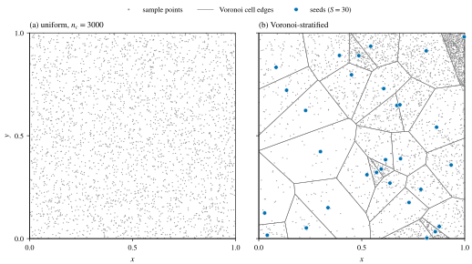
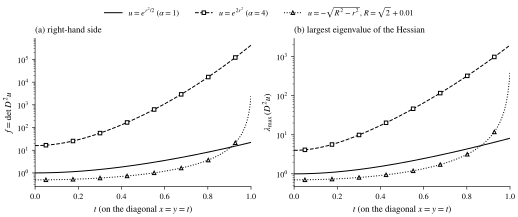
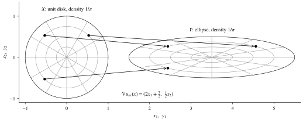

## 引言 \label{sec:intro}

用神经网络求解 Monge–Ampère 方程, 最直接的做法是 PINN: 把方程残差 $\det D^2 u_\theta - f$ 和边界项放进损失, 一次训练完. 一方面, 这种做法实现简单, 在光滑的问题上也确实很快. 另一方面, 它把整个非线性一次性交给优化器, 损失里同时出现 Hessian 的行列式和边界项, 问题一变难, 训练就可能不稳定. 另外, 损失本身并不知道解应当是凸的, 这一点在 [前一篇文章](../mae-convexity-branch/) 中已经讨论过.

Caboussat, Leclercq 和 Peruso 的预印本 \cite{caboussat2026} 走的是另一条路. 它沿用有限元方法中的最小二乘分裂 \cite{caboussat2013}: 引入一个矩阵场 $P \approx D^2 u$, 交替求解两个子问题, 一个是逐点的非线性投影, 一个是线性的变分问题. 后者有天然的能量形式, 所以作者用 Deep Ritz 方法 \cite{e2018} 求解, 需要凸性时网络取输入凸神经网络 (ICNN) \cite{amos2017}, 配点则按局部缺陷自适应地重新采样.

本文按以下顺序整理这篇论文. 第 \ref{sec:problem} 节说明问题和难点. 第 \ref{sec:method} 节给出方法的全部组成部分. 第 \ref{sec:theory} 节整理文中的理论依据. 第 \ref{sec:setup} 节是实验的共同设置, 第 \ref{sec:dirichlet} 节和第 \ref{sec:ot} 节逐个介绍 Dirichlet 问题和最优传输问题的实验. 第 \ref{sec:discussion} 节讨论这些结果能说明什么, 不能说明什么. 文中的数字都取自原文 (arXiv v2, 2026 年 9 月 29 日). 图都是我们自己画的, 没有使用原文的图: 三张按原文的公式或表格画出, 一张是我们自己的演示.

## 问题与难点 \label{sec:problem}

原文考虑二阶完全非线性方程: 求 $u : \Omega \to \R$, 使得

$$
F(D^2 u, \nabla u, u, \bx) = 0, \qquad \bx \in \Omega \subset \R^d,
$$

其中 $F$ 至少对 $D^2 u$ 的某个分量是非线性的, 并配上 Dirichlet 边界条件. "完全非线性" 是指非线性作用在最高阶导数上. 文中列出四个例子, 其中 $\lambda_i$ 是 $D^2 u$ 的特征值:

- Monge–Ampère 方程: $F = \det D^2 u - f$.
- Pucci 方程: $F = \alpha \sum \lambda_+(D^2 u) + \sum \lambda_-(D^2 u) - f$, 其中 $\alpha > 1$, $\lambda_+$ 和 $\lambda_-$ 分别是正特征值和负特征值.
- $\sigma_2$ 方程: $F = \sigma_2(D^2 u) - f$, 其中 $\sigma_2(D^2 u) = \sum_{i<j} \lambda_i \lambda_j$.
- Minkowski 方程 (预定 Gauss 曲率): $F = \det D^2 u - K(\bx)(1 + \abs{\nabla u}^2)^{(d+2)/2}$, 其中 $K > 0$.

作者指出这类方程有两个难点. 一是适定性很微妙: 解的存在和唯一一般需要额外的结构条件, 例如解的凸性或算子的单调性. 对 Monge–Ampère 方程, 凸性就是选解的条件, 见 [前一篇文章](../mae-convexity-branch/). 二是这些方程是非散度型的, 没有弱形式, 所以不能直接用线性和半线性方程常用的变分方法 (有限元, Deep Ritz) 来离散. 直接 PINN 绕开了第二个难点, 因为它只需要在配点上算强形式的残差; 但它要求网络在每个配点上满足完整的非线性方程, 凸性也要另外处理.

## 方法 \label{sec:method}

### 最小二乘分裂 \label{sec:split}

先看 Dirichlet 问题 $F(D^2 u) = 0$ 于 $\Omega$, $u = \varphi$ 于 $\partial\Omega$. 引入矩阵场 $P : \Omega \to \R^{d \times d}_{\mathrm{sym}}$, 把问题写成等价的耦合形式

$$
D^2 u = P, \qquad F(P) = 0 \quad \text{in } \Omega, \qquad u = \varphi \quad \text{on } \partial\Omega,
$$

再写成带非线性约束的最小二乘问题

$$
\begin{equation}
  (u, P) = \operatorname*{arg\,min}_{\substack{v \in H^2(\Omega) \cap H^1_\varphi(\Omega) \\ Q \in L^2(\Omega; \R^{d\times d}_{\mathrm{sym}})}} \Bigl\{ J(v, Q) \ \text{s.t.}\ F(Q) = 0 \Bigr\}, \qquad J(v, Q) = \frac12 \int_\Omega \abs{D^2 v - Q}^2 ,
  \label{eq:ls}
\end{equation}
$$

其中 $\abs{\cdot}$ 是 Frobenius 范数, $H^1_\varphi(\Omega) = \{ v \in H^1(\Omega) : v = \varphi \text{ on } \partial\Omega \}$. 直接求解 \eqref{eq:ls} 比较麻烦, 所以用块坐标下降把非线性和微分算子分开: 给定 $u^0$, 对 $n \ge 0$ 依次求

$$
\begin{equation}
  P^n = \operatorname*{arg\,min}_{Q} \bigl\{ J(u^n, Q) \ \text{s.t.}\ F(Q) = 0 \bigr\}, \qquad
  u^{n+1} = \operatorname*{arg\,min}_{v \in H^2(\Omega) \cap H^1_\varphi(\Omega)} J(v, P^n).
  \label{eq:split}
\end{equation}
$$

两个子问题的性质很不一样. 第一个子问题是非线性的, 但它是局部的: 对每个点 $\bx$, 它就是在 Frobenius 范数下找离 $D^2 u^n(\bx)$ 最近, 并且满足 $F(Q) = 0$ 的对称矩阵. 约束是旋转不变的时候 (Monge–Ampère, Pucci, $\sigma_2$ 都是这样), 它还可以化成只关于 $Q$ 的特征值的小问题. 原文直接使用已有的逐点求解器 (原文文献 [24, 26, 30]), 在计时实验中, 这一步最多只占一次变分更新 CPU 时间的约 $0.12\%$. 第二个子问题与 $F$ 无关, 是线性的, 它的强形式是一个四阶的双调和型方程, 在有限元实现中它是主要的计算瓶颈. 原文的出发点是: 既然它本来就以变分形式给出, 就可以直接用 Deep Ritz 求解.

原文的 \eqref{eq:split} 只写了约束 $F(Q) = 0$, 对 Monge–Ampère 方程即 $\det Q = f$. 二维时, 这个集合同时含有正定矩阵和负定矩阵 ($\det(-Q) = \det Q$), 正好对应 [前一篇文章](../mae-convexity-branch/) 中的凸解和凹解两支. 这一框架最早的有限元版本 \cite{caboussat2013} 把约束集合取为 $\{ q : \det q = f,\ q_{11} > 0,\ q_{22} > 0 \}$ (该文式 (2.5)), 也就是只保留正定的一支. 2026 年的这篇论文没有在式子中写出这一条, 而是把凸性交给网络结构: Monge–Ampère 型的问题用 ICNN, 只要权重满足非负约束, 网络输出就是凸函数.

初值取 Poisson 问题的解

$$
\Delta u^0 = 2\sqrt{f} \quad \text{in } \Omega, \qquad u^0 = \varphi \quad \text{on } \partial\Omega .
$$

理由是: 二维时若 $D^2 u$ 的两个特征值接近, $\lambda_1 \approx \lambda_2$, 则 $\Delta u = \lambda_1 + \lambda_2 \approx 2\lambda_1 \approx 2\sqrt{\det D^2 u} = 2\sqrt{f}$. 这个初值本身也用 Deep Ritz 训练得到.

### 推广到依赖梯度的方程 \label{sec:general}

Gauss 曲率方程和最优传输问题中, $F$ 还依赖 $\nabla u$. 原文的处理很简单: 把梯度取成上一步的值, 投影步改为

$$
P^n = \operatorname*{arg\,min}_{Q} \bigl\{ J(u^n, Q) \ \text{s.t.}\ F(Q, \nabla u^n) = 0 \bigr\},
$$

变分步不变. 对 Gauss 曲率方程

$$
\det D^2 u = K (1 + \abs{\nabla u}^2)^{(d+2)/2} \quad \text{in } \Omega, \qquad u = \varphi \quad \text{on } \partial\Omega,
$$

椭圆性要求 $u$ 凸. 作者说明, 在第 \ref{sec:dirichlet} 节的实验中用的都是这种显式梯度的写法, 数值上都观察到了收敛; 另一种做法是像文献 \cite{liu2024} 那样引入辅助变量 $\mathbf{b} \approx \nabla u$.

对二次代价的最优传输, 由 Brenier 定理 (见定理 \ref{thm:brenier}), 最优映射是一个凸势函数的梯度 $T = \nabla u$, 而 $u$ 满足

$$
\det D^2 u = \frac{\mu_0}{\mu_1(\nabla u)} \quad \mu_0\text{-a.e. in } X, \qquad \nabla u(\partial X) = \partial Y .
$$

右端依赖 $\nabla u$, 所以投影步同样用显式梯度. 难点在第二个条件, 即传输边界条件: 它不是 Dirichlet 条件, 而是要求 $\nabla u$ 把源区域的边界映到目标区域的边界上. 它的处理见第 \ref{sec:otbc} 节.

### Deep Ritz 步与网络 \label{sec:ritz}

变分步 \eqref{eq:split} 是线性的, 原文指出它是适定的, 因为 $\int_\Omega \abs{D^2 \cdot}^2$ 是 $H^2(\Omega) \cap H^1_0(\Omega)$ 上的范数. 网络空间一般不满足边界条件, 所以边界条件用罚项弱施加, 再用 Monte Carlo 离散积分. 设 $\{\bx_{c,i}\}_{i=1}^{n_c}$ 是区域内均匀采样的配点, $\{\bx_{b,i}\}_{i=1}^{n_b}$ 是边界上均匀采样的点, 第 $n$ 次外层迭代的损失是

$$
\begin{align*}
  L(v) &= L_{\mathrm{PDE}}(v) + \lambda\, L_{\mathrm{BC}}(v), \\
  L_{\mathrm{PDE}}(v) &= \frac{1}{n_c} \sum_{i=1}^{n_c} \abs{D^2 v(\bx_{c,i}) - P^n(\bx_{c,i})}^2, \\
  L_{\mathrm{BC}}(v) &= \frac{1}{n_b} \sum_{i=1}^{n_b} \bigl( v(\bx_{b,i}) - \varphi(\bx_{b,i}) \bigr)^2 ,
\end{align*}
$$

$u^{n+1}_{NN}$ 取为它的极小点. 与 PINN 的损失相比, 这里没有 $\det$, 也没有任何非线性: 网络只需要在给定的矩阵场 $P^n$ 下拟合 Hessian. 作者选 Deep Ritz 而不选 PINN 来解这一步, 理由是问题本来就是变分形式的, 不需要算更高阶的导数 (双调和方程的强形式要四阶导数), 也不需要额外的正则性假设.

网络有两种. 不要求凸性的问题 (Pucci 方程) 用普通的全连接网络. 要求凸解的问题用 ICNN \cite{amos2017}:

$$
\begin{align*}
  \bx_1 &= \sigma(L^{(0)} \bx + b^{(0)}), \\
  \bx_l &= \sigma(W^{(l-1)} \bx_{l-1} + L^{(l-1)} \bx + b^{(l-1)}), \qquad 2 \le l \le L, \\
  y &= W^{(L)} \bx_L + L^{(L)} \bx + b^{(L)},
\end{align*}
$$

其中 $W^{(l)}$ 的元素非负, 跳连矩阵 $L^{(l)}$ 不受限制, $\sigma$ 是单调递增的凸函数. 凸性来自两个基本事实: 凸函数的非负线性组合是凸的, 凸函数与单调递增凸函数的复合是凸的. 跳连层是必要的: 权重非负使隐藏层难以表示恒等映射, 跳连把输入直接送到深层, 补回一部分表达能力. 原文的具体选择如下:

- 除非另外说明, 网络有 $4$ 个隐藏层, 每层 $10$ 个神经元.
- ICNN 的激活函数取 softplus, $\sigma(x) = \log(1 + e^x)$, 它光滑, 单调递增, 严格凸. 原文写的是, 为保证 $W^{(l)}$ 非负, 权重在初始化时逐元素取平方; 训练中怎样保持非负, 原文没有说明.
- 优化器分两段: 先用 Adam 预训练, 再用 L-BFGS 精调. L-BFGS 的设置见表 \ref{tab:optim}. 外层迭代前期每次最多用 $70$ 个 L-BFGS epoch, 后期逐渐减到 $4$ 个. 作者的理由是前一步的解给了下一步很好的初值, 后期只需要少量训练.

:::table{#tab:optim}
| 设置 | 取值 |
| :-- | :-- |
| 主优化器 | L-BFGS |
| 线搜索 | strong Wolfe |
| L-BFGS 历史长度 | 25 |
| 每次调用的最大迭代数 | 20 |
| 梯度容差 (L-BFGS) | $10^{-7}$ |
| 批大小 | 全批量 |

Deep Ritz 求解器的训练设置, 取自原文表 1. 原文没有给出 Adam 阶段的学习率和步数.
:::

### 自适应采样 \label{sec:adaptive}

Monte Carlo 积分的精度也影响 Deep Ritz 的精度. 被积函数集中在局部时, 均匀采样效率不高. 原文的出发点是重要性采样: 对 $\Omega$ 上任何处处为正的概率密度 $q$,

$$
\int_\Omega \abs{D^2 v - P^n}^2 \,\mathrm{d}\bx = \mathbb{E}_{X \sim q} \Bigl[ \frac{\abs{D^2 v(X) - P^n(X)}^2}{q(X)} \Bigr],
$$

所以按 $q$ 独立采样得到的估计量是无偏的. 形式上使方差最小的密度正比于缺陷 $d(\bx) := \abs{D^2 v(\bx) - P^n(\bx)}^2$, 其中 $v$ 是更新采样分布时的网络. 在所有配点上算 $d$ 代价太大, 作者参考 Nabian 等的做法 \cite{nabian2021}, 用分片常数来近似这个密度:

1. 随机取 $S \ll n_c$ 个种子点 $X_1, \dots, X_S$, 它们按最近邻规则把 $\Omega$ 分成 Voronoi 单元 $C_1, \dots, C_S$.
2. 在单元 $C_s$ 中均匀采 $n_s = n_c\, d(X_s) / \sum_{j=1}^S d(X_j)$ 个点.
3. 用加权和近似 PDE 项:

$$
\widetilde{L}_{\mathrm{PDE}}(v) = \sum_{s=1}^{S} \frac{\abs{C_s}}{n_s} \sum_{i=1}^{n_s} \abs{D^2 v(X_{s,i}) - P^n(X_{s,i})}^2, \qquad X_{s,i} \sim U(C_s),
$$

其中单元体积 $\abs{C_s}$ 用一组均匀的 Monte Carlo 样本估计. 每次更新密度只需要在 $S$ 个种子点上算 Hessian, 再做一次最近邻分配. 图 \ref{fig:voronoi} 用一个我们自己选的指标函数演示了这一规则. 作者也指出了它的局限: 分片常数对理想密度的近似可能比较粗, 效果取决于种子的数目.

:::figure{#fig:voronoi .invert-dark}

自适应采样规则的示意 (我们的演示, 不是原文的结果). 灰色小点是配点, 灰色细线是 Voronoi 单元的边界, 蓝色圆点是种子. (a) $3000$ 个均匀配点. (b) $30$ 个种子的 Voronoi 单元, 每个单元的点数正比于种子处的指标值 (取整). 这里的指标取 $\alpha = 1$ 时精确解 $e^{r^2/2}$ 的 $\abs{D^2 u}^2$, 只因为它向 $(1,1)$ 增大; 原文用的是当前网络的缺陷 $\abs{D^2 v - P^n}^2$.
:::

### 传输边界条件 \label{sec:otbc}

对最优传输问题, 损失中的 Dirichlet 罚项换成传输边界条件的罚项, 做法沿用其中两位作者此前的凸 PINN 工作 \cite{caboussat2025}. 利用

$$
\nabla u(\partial X) = \partial Y \iff d_H\bigl(\nabla u(\partial X), \partial Y\bigr) = 0,
$$

其中 $d_H(A, B) = \max\{ \sup_{a \in A} \operatorname{dist}(a, B), \sup_{b \in B} \operatorname{dist}(b, A) \}$ 是 Hausdorff 距离. 两个上确界分别对应包含关系 $\nabla u(\partial X) \subseteq \partial Y$ 和 $\partial Y \subseteq \nabla u(\partial X)$. 取源边界上的点 $\{\bx_{X,i}\}_{i=1}^{n_{bX}}$ 和目标边界上的点 $\{\by_{Y,j}\}_{j=1}^{n_{bY}}$, 离散的边界项为

$$
\begin{align*}
  L_{\mathrm{OT}}(v) &= \frac{1}{n_{bX}} \sum_{i=1}^{n_{bX}} \operatorname{dist}\Bigl( \nabla v(\bx_{X,i}),\ \{\by_{Y,j}\}_{j} \Bigr)^2 + \frac{1}{n_{bY}} \sum_{j=1}^{n_{bY}} \operatorname{dist}\Bigl( \{\nabla v(\bx_{X,i})\}_{i},\ \by_{Y,j} \Bigr)^2 ,
\end{align*}
$$

总损失为 $L_{\mathrm{PDE}} + \lambda L_{\mathrm{OT}}$. 第一项对应包含关系 $\nabla v(\partial X) \subseteq \partial Y$ (原文称之为惩罚对单射的偏离), 第二项对应 $\partial Y \subseteq \nabla v(\partial X)$ (原文称之为保证满射). 这一做法是通用的, 但计算量较大. 作者还提到, 源区域和目标区域是同一个正方形时, 传输边界条件等价于一个 Neumann 条件, 可以简化, 但文中没有这样做.

### 算法小结

把上面几部分放在一起, 一次完整的求解是:

1. 用 Deep Ritz 求解 Poisson 问题 $\Delta u^0 = 2\sqrt{f}$ 得到初值 (Pucci 方程也用这个问题, 原文说这对应 $f = 0$, $\alpha = 1$ 的情形; 最优传输问题则取 $\nabla u^0$ 为恒等映射).
2. 对 $n = 0, 1, 2, \dots$: 在配点上逐点求解投影问题得到 $P^n(\bx_{c,i})$; 以上一步的网络为初值, 用 Adam 加 L-BFGS 最小化 Deep Ritz 损失得到 $u^{n+1}_{NN}$, 训练中按 Voronoi 规则重新采样配点.
3. 每次外层迭代结束时, 计算与精确解的 $L^2$, $H^1$, $H^2$ 误差 (实验中的误差曲线就是这样得到的).

## 理论依据 \label{sec:theory}

这篇论文是方法与实验论文, 文中没有新的定理. 它用到的数学事实可以整理成下面几条, 我们按原文的假设写出.

:::proposition[分裂的相容性]{#prop:consistent}
(\cite[§2]{caboussat2026}) 若 $u \in H^2(\Omega)$ 是 Dirichlet 问题 $F(D^2 u) = 0$, $u = \varphi$ 的解, 则 $(u, P) = (u, D^2 u)$ 满足耦合问题 $D^2 u = P$, $F(P) = 0$, $u = \varphi$.
:::

这只是一个方向的陈述. 反过来, \eqref{eq:split} 的迭代是否收敛, 收敛到哪个解, 原文没有证明, 而是引用了有限元情形下的分析 (原文文献 [10, 28, 29]), 其中 [28] 是 Peruso 和 Sorella 2026 年关于该分裂方法收敛性的工作. 我们没有读这几篇, 所以这里不转述它们的结论. [TODO: 读 Peruso–Sorella 2026, 补充分裂迭代收敛性的假设和结论.]

:::proposition[变分步的适定性]{#prop:wellposed}
(\cite[§4.2]{caboussat2026}) 变分步 $\min \{ \int_\Omega \abs{D^2 v - P^n}^2 : v \in H^2(\Omega),\ v|_{\partial\Omega} = \varphi \}$ 是适定的, 因为 $\int_\Omega \abs{D^2 \cdot}^2$ 是 $H^2(\Omega) \cap H^1_0(\Omega)$ 上的范数.
:::

原文没有写出对 $\Omega$ 的要求, 但有界 Lipschitz 区域就够了. 对 $v \in H^2(\Omega) \cap H^1_0(\Omega)$, 分部积分和 Poincaré 不等式给出 $\norm{\nabla v}^2 = -\int_\Omega v \Delta v \le C_P \norm{\nabla v} \, \norm{\Delta v}$, 又逐点有 $\abs{\Delta v} \le \sqrt d\, \abs{D^2 v}$, 所以 $\norm{v}_{H^2(\Omega)} \le C \norm{D^2 v}_{L^2(\Omega)}$, 即这个范数与 $H^2$ 范数等价. 再设 $\varphi$ 是某个 $H^2(\Omega)$ 函数的迹, 变分步就是 $L^2$ 中到闭子空间 $D^2(H^2(\Omega) \cap H^1_0(\Omega))$ 的投影, 极小点存在且唯一. 另外, 网络空间一般不在 $H^2(\Omega) \cap H^1_\varphi(\Omega)$ 中, 所以实际求解的是带罚项的问题; 激活函数足够光滑时, 网络空间包含在 $H^2(\Omega)$ 中. 对网络近似和罚项带来的误差, 原文没有给出估计.

:::theorem[Brenier]{#thm:brenier}
(按 \cite[§3]{caboussat2026} 的表述) 设 $\mu_0, \mu_1$ 是 $\R^d$ 上绝对连续的概率测度, 支撑 $X, Y$ 紧, 密度在各自的支撑上上下有界. 则对二次代价 $c(\bx, \by) = \frac12 \abs{\bx - \by}^2$: (i) 存在唯一的最优传输映射 $T$; (ii) 存在凸势函数 $u : X \to \R$, 使得 $\mu_0$-几乎处处 $T = \nabla u$, 并且 $u$ 满足 $\det D^2 u = \mu_0 / \mu_1(\nabla u)$ ($\mu_0$-a.e.) 以及传输边界条件 $\nabla u(\partial X) = \partial Y$.
:::

严格地说, 这是两个结果合在一起. Brenier 定理本身 \cite[Theorem 4.22]{figalli2017} 给出 (i) 和 $T = \nabla u$; 要让方程在 Alexandrov 意义或经典意义下成立, 需要 Caffarelli 的正则性结果, 它要求目标区域凸 \cite[§4.6.1]{figalli2017}; 边界条件 $\nabla u(\partial X) = \partial Y$ 还要求 $\nabla u$ 到边界为止是同胚, 例如密度光滑, 两个区域都光滑且一致凸 \cite[Remark 4.25]{figalli2017}. 原文第 7.1 节的圆盘和椭圆满足这些条件, 第 7.2 节的正方形是凸的, 但有角.

:::proposition[重要性采样]{#prop:is}
(\cite[§4.3]{caboussat2026}) 对 $\Omega$ 上处处为正的概率密度 $q$ 和独立样本 $X_i \sim q$, 估计量 $\frac{1}{n_c} \sum_i \abs{D^2 v(X_i) - P^n(X_i)}^2 / q(X_i)$ 是 $\int_\Omega \abs{D^2 v - P^n}^2$ 的无偏估计; 形式上, 方差最小的密度是 $q^\star = d / \int_\Omega d$, 其中 $d = \abs{D^2 v - P^n}^2$.
:::

实际使用的 Voronoi 分层估计量 $\widetilde{L}_{\mathrm{PDE}}$ 是在每个单元内做均匀采样, 在给定种子, 单元体积精确, 并且每个单元都有点 ($n_s \ge 1$) 的条件下, 它也是无偏的. 但 $n_s = n_c\, d(X_s) / \sum_j d(X_j)$ 一般不是整数, 缺陷小的单元可能分不到点. 原文没有说明怎样取整, 也没有说明 $n_s = 0$ 的单元怎样处理; 原文图 6 和图 10 中确实有大片没有配点的区域.

最后是 ICNN 的凸性 (见第 \ref{sec:ritz} 节), 它对任何满足 $W^{(l)} \ge 0$ 的参数都成立. 但 ICNN 只保证凸, 不保证 Hessian 有正的下界, 也就是不保证一致凸.

## 实验设置 \label{sec:setup}

所有实验都是二维的, 用 PyTorch 实现. 原文的误差曲线都是 $10$ 次独立运行的平均, 阴影是 $5\%$ 到 $95\%$ 分位数. 误差只在每次外层迭代结束时计算. 表 \ref{tab:tests} 汇总了全部测试问题.

:::table{#tab:tests}
| 原文节号 | 方程 | 区域 | 精确解或数据 | 网络 | 配点 / 边界点 |
| :-- | :-- | :-- | :-- | :-- | :-- |
| 6.1 | Monge–Ampère | $[0,1]^2$ | $u = e^{(\alpha/2)(x^2+y^2)}$, $\alpha = 1, 4$ | ICNN | 3000 / 300 |
| 6.2 | Monge–Ampère | $[0,1]^2$ | $u = -\sqrt{R^2 - (x^2+y^2)}$, $R = \sqrt2 + 0.01$ | ICNN | 3000 / 300 |
| 6.3 | Monge–Ampère | 单位圆盘 | $f = 1$, $g = 0$, $u = \frac12(x^2+y^2-1)$ | ICNN | 3000 / 300 |
| 6.4 | Pucci | $[0,1]^2$ | $u = -((x+1)^2+(y+1)^2)^{(1-\alpha)/2}$, $\alpha = 2, 3, 5$ | 全连接 (softplus) | 3000 / 300 |
| 6.5 | Gauss 曲率 | $[0,1]^2$ | $u = \abs{\bx - \mathbf{b}}^2$, $\mathbf{b} = (\frac12, \frac12)$ | ICNN | 3000 / 300 |
| 7.1 | 最优传输 | 圆盘 $\to$ 椭圆 | 均匀密度, $\nabla u_{ex}$ 已知 | ICNN | 1000 / 1000 |
| 7.2 | 最优传输 | $[0,1]^2$ | 三组 Gaussian 型密度 | ICNN | 未给出 |

全部测试问题, 取自原文第 6 节和第 7 节. "网络" 一列按原文第 5 节的规则 (要求凸解的问题用 ICNN) 填写; 原文没有对第 7 节单独说明.
:::

边界罚项的权重, Monge–Ampère 的第一个算例取 $\lambda = 100$, Pucci 方程取 $\lambda = 1000$, 其他算例原文没有给出. 对比的 PINN 按 Nyström 和 Vestberg \cite{nystrom2023} 的方法实现, 原文图 3 和图 7 的图注说明 PINN 使用相同的总 epoch 数; 除此之外, PINN 的网络, 损失权重和优化器设置原文都没有给出. [TODO: 核对 Nyström–Vestberg 的 PINN 是否用了 ICNN 或迹罚项, 以及网络和优化器设置, 以判断 2/10 这个基线有多强.]

## Dirichlet 问题的实验 \label{sec:dirichlet}

### 指数型精确解 \label{sec:exp}

第一个算例是 $\Omega = [0,1]^2$ 上的 Monge–Ampère 方程, 精确解为 $u = e^{(\alpha/2)(x^2+y^2)}$. 直接计算可得 $D^2 u = u\,(\alpha I + \alpha^2 \bx \bx^\top)$, 所以

$$
f = \det D^2 u = \alpha^2 (1 + \alpha r^2)\, e^{\alpha r^2}, \qquad r = \abs{\bx}.
$$

$\alpha = 1$ 是标准测试问题. $\alpha = 4$ 时解的梯度更陡. 图 \ref{fig:data} 说明了 $\alpha = 4$ 为什么难得多: 在对角线上, $f$ 从原点的 $16$ 增长到 $(1,1)$ 处的约 $4.3 \times 10^5$, 相差约 $2.7 \times 10^4$ 倍, Hessian 的最大特征值从 $4$ 增长到约 $2.0 \times 10^3$; 而 $\alpha = 1$ 时 $f$ 只从 $1$ 增长到约 $22$. (这些数是我们按公式算的.)

:::figure{#fig:data .invert-dark}

第 6.1 节和第 6.2 节三个算例的数据, 按精确解的公式计算. 黑色实线是 $\alpha = 1$, 黑色虚线加空心方块是 $\alpha = 4$, 黑色点线加空心三角是第 6.2 节的解. (a) 右端项. (b) Hessian 的最大特征值. $\alpha = 4$ 时 $f$ 跨越四个多数量级, 最大特征值跨越将近三个; 第 6.2 节的解在 $(1,1)$ 附近急剧增大.
:::

结果如下.

- $\alpha = 1$ 时, 原文的说法是 PINN 收敛更快, Deep Ritz 的波动更小 (原文图 3). 从原文图 3 看, 这个算例上 PINN 最终的 $L^2$, $H^2$ 误差曲线低于不加自适应采样的 Deep Ritz, 但 PINN 的损失曲线反复出现明显的尖峰. 加上自适应采样后, Deep Ritz 的误差下降更快, 最终也更低; 种子数取 $S = 30, 60, 150$ 的曲线几乎重合, 作者据此认为种子数超过中等数目后收益不大 (原文图 4). 逐点误差图显示, 自适应采样使误差下降得更快 (原文图 5).
- $\alpha = 4$ 时, 作者的说法是 PINN 明显不稳健, Deep Ritz 仍然稳定 (原文图 7). 从原文图 7 看, PINN 的误差带很宽, 平均误差曲线比 Deep Ritz 高一个数量级以上 (读图, 只看量级). 自适应采样的作用比 $\alpha = 1$ 时更明显 (原文图 8, 图 9), 配点逐渐集中到解和导数变化最快的 $(1,1)$ 附近 (原文图 10).

原文唯一的定量对比是表 \ref{tab:cost}: 每种方法运行 $10$ 次, 记录 Hessian 相对误差首次低于 $5\%$ 的墙钟时间; 达不到阈值的运行按时间上限计入平均值. 图 \ref{fig:cost} 把表中的数字画了出来.

:::table{#tab:cost}
| 方法 | $\alpha$ | 成功次数 | 平均时间 (分钟) | 相对 Deep Ritz 的加速 |
| :-- | :-: | --: | --: | --: |
| Deep Ritz | 1 | 10/10 | 6.01 | 1.00× |
| PINN | 1 | 10/10 | 1.61 | 3.72× |
| 自适应 Deep Ritz, $S = 30$ | 1 | 10/10 | 2.22 | 2.71× |
| 自适应 Deep Ritz, $S = 60$ | 1 | 10/10 | 2.11 | 2.84× |
| 自适应 Deep Ritz, $S = 150$ | 1 | 10/10 | 2.32 | 2.59× |
| Deep Ritz | 4 | 6/10 | 9.21 | 1.00× |
| PINN | 4 | 2/10 | 9.39 | 0.98× |
| 自适应 Deep Ritz, $S = 30$ | 4 | 10/10 | 3.58 | 2.57× |
| 自适应 Deep Ritz, $S = 60$ | 4 | 10/10 | 3.94 | 2.33× |
| 自适应 Deep Ritz, $S = 150$ | 4 | 9/10 | 4.12 | 2.24× |

指数型算例达到 $5\%$ Hessian 相对误差的成功次数和平均墙钟时间, 数据取自原文表 2. 失败的运行按时间上限计入; 原文没有给出上限的数值和硬件.
:::

:::figure{#fig:cost .invert-dark}

表 \ref{tab:cost} 的数字, 数据取自原文表 2. ADR 表示自适应 Deep Ritz. 颜色区分方法: 紫色是 Deep Ritz, 绿色是 PINN, 蓝色是 ADR; 斜线空心柱是 $\alpha = 1$, 实心柱是 $\alpha = 4$. (a) 10 次运行中 Hessian 相对误差低于 $5\%$ 的次数. (b) 平均墙钟时间, 失败的运行按时间上限计入.
:::

这张表有两层意思. $\alpha = 1$ 时, 所有方法都能达到阈值, PINN 最快, 平均 $1.61$ 分钟, 不到标准 Deep Ritz 的三分之一; 自适应 Deep Ritz 约 $2.1$ 到 $2.3$ 分钟, 比 PINN 略慢. $\alpha = 4$ 时情况反过来: PINN 只有 $2$ 次达到阈值, 标准 Deep Ritz 有 $6$ 次, 自适应 Deep Ritz 有 $9$ 到 $10$ 次, 平均时间约 $3.6$ 到 $4.1$ 分钟, 相对标准 Deep Ritz 加速约 $2.2$ 到 $2.6$ 倍. 因为失败的运行按上限计时, PINN 在 $\alpha = 4$ 时的 $9.39$ 分钟主要反映的是失败, 而不是它真实的收敛速度. 假设所有运行共用同一个时间上限 $C$, 还可以反推它的范围: PINN 有 $8$ 次失败, $2$ 次成功的时间 $t_1, t_2 \in (0, C]$, 由 $8C + t_1 + t_2 = 93.9$ 得 $9.39 \le C < 11.74$ 分钟 (我们的推算).

### 梯度陡峭的解 \label{sec:sharp}

第二个算例的精确解是

$$
u = -\sqrt{R^2 - (x^2 + y^2)}, \qquad R \ge \sqrt2 ,
$$

我们算得 $f = R^2 / (R^2 - r^2)^2$. $R > \sqrt2$ 时 $u \in C^\infty(\overline\Omega)$; $R = \sqrt2$ 时梯度在 $(1,1)$ 处奇异, $u \notin H^2(\Omega)$. 原文取 $R = \sqrt2 + 0.01$, 此时 $f$ 在对角线上从约 $0.49$ 增长到约 $2.5 \times 10^3$ (图 \ref{fig:data}, 我们的计算). 结果: PINN 和 Deep Ritz 精度相当, Deep Ritz 的波动更小 (原文图 11); 自适应采样进一步改进 Deep Ritz, 对种子数不敏感 (原文图 12), 并使逐点误差更小, 分布更均匀 (原文图 13). 这个算例没有表 \ref{tab:cost} 那样的计时对比.

### 单位圆盘 \label{sec:disk}

第三个算例在单位圆盘上取 $f = 1$, $g = 0$, 精确解 $u = \frac12(x^2 + y^2 - 1)$. 它就是 [前一篇文章](../mae-convexity-branch/) 中凸解 $u_+$ 减去常数 $\frac12$; 同一个边界条件下, $-u = \frac12(1 - x^2 - y^2)$ 也满足方程, 是凹的那一支. ICNN 的输出总是凸的, 所以从结构上排除了凹解. 作者用这个算例说明方法可以直接处理曲边界 (原文图 14). 作者认为自适应采样减小了逐点误差并使它分布更均匀 (原文图 15); 不过在原文图 15 中, 两行使用同一个色标, 后几次迭代的两行看上去差别不大.

### Pucci 方程 \label{sec:pucci}

Pucci 方程的投影步换成文献 \cite{caboussat2019} 的求解器. 因为不要求凸性, 网络换成 softplus 激活的普通全连接网络, $\lambda = 1000$. 精确解为

$$
u = -\bigl((x+1)^2 + (y+1)^2\bigr)^{(1-\alpha)/2}, \qquad \alpha = 2, 3, 5 .
$$

这里补一个简单的计算 (原文没有写出). 记 $\rho = \abs{\bx + (1,1)}$, 则 $u = -\rho^{1-\alpha}$ 是径向函数, 径向特征值为 $u'' = -\alpha(\alpha-1)\rho^{-\alpha-1} < 0$, 切向特征值为 $u'/\rho = (\alpha-1)\rho^{-\alpha-1} > 0$, 所以 $\alpha \lambda_+ + \lambda_- = 0$, 即 $f = 0$. 这个解在每一点都是鞍形的, 既不凸也不凹, 所以这里不能用 ICNN. 结果: $\alpha = 2, 3, 5$ 时方法都稳定, 精确 (原文图 16). 这个算例没有和 PINN 比较.

### Gauss 曲率方程 \label{sec:gauss}

最后一个 Dirichlet 算例是 Minkowski 问题 (二维时指数 $(d+2)/2 = 2$):

$$
\det D^2 u = K(\bx)(1 + \abs{\nabla u}^2)^2 \quad \text{in } \Omega = [0,1]^2, \qquad K(\bx) = \frac{4}{(1 + 4\abs{\bx - \mathbf{b}}^2)^2}, \qquad \mathbf{b} = (\tfrac12, \tfrac12),
$$

边界值 $g = \abs{\bx - \mathbf{b}}^2$, 精确解 $u = \abs{\bx - \mathbf{b}}^2$ (此时 $D^2 u = 2I$, $\abs{\nabla u}^2 = 4\abs{\bx - \mathbf{b}}^2$, 容易验证). 尽管非线性项依赖梯度, 收敛的情况与前面的方程差不多 (原文图 17), 自适应采样明显减小了逐点误差, 也使它更均匀 (原文图 18). 这个算例也没有和 PINN 比较.

## 最优传输问题的实验 \label{sec:ot}

### 圆盘到椭圆

源区域是单位圆盘 $X$, 目标区域是椭圆 $Y = \{ (y_1 - 3.5)^2 / 2^2 + y_2^2 / 0.5^2 < 1 \}$, 两边都是均匀密度 $1/\pi$ (椭圆的面积是 $\pi \cdot 2 \cdot 0.5 = \pi$, 所以两个密度都是概率密度). 精确解为

$$
u_{ex}(\bx) = x_1^2 + \frac14 x_2^2 + \frac72 x_1 - \frac{5}{16}, \qquad \nabla u_{ex}(\bx) = \Bigl( 2x_1 + \frac72,\ \frac12 x_2 \Bigr),
$$

$\det D^2 u_{ex} = 2 \cdot \frac12 = 1$, 与两个密度之比一致. 图 \ref{fig:ot} 画出了这个映射. 初值取 $\nabla u^0$ 为恒等映射, 损失用 $1000$ 个配点和 $1000$ 个边界点离散. 原文图 19 显示, 加自适应采样时误差下降更快 (这里的 $L^2$ 误差是减去均值后计算的, 因为势函数只确定到一个常数). 原文图 20 用 $10^6$ 个均匀样本, 比较了 $30$ 次外层迭代后近似映射的推前分布和精确的目标分布, 两者非常接近.

:::figure{#fig:ot .invert-dark}

第 7.1 节算例的精确映射 $\nabla u_{ex}$, 按原文给出的公式画出: 黑色实线是圆盘和椭圆的边界, 圆盘的极坐标网格 (灰色细线) 被映成椭圆中的网格, 黑点和箭头是几个样本点及其像.
:::

### Gaussian 型密度

第二组算例在 $\Omega = [0,1]^2$ 上, 依次变难:

1. Gaussian 源 $f_1 = c_1 \exp(-\abs{\bx - \bx_0}^2 / (2\sigma^2))$, $\bx_0 = (0.25, 0.75)$, $\sigma^2 = 0.25$, 目标为均匀分布.
2. 各向异性的双峰源 $f_2$, 两个峰的中心是 $(0.5, 0.2)$ 和 $(0.5, 0.8)$, $\sigma_{xx}^2 = 0.25$, $\sigma_{yy}^2 = 0.015625$, 目标为均匀分布.
3. 同一个双峰源 $f_2$, 目标为中心在 $(0.5, 0.5)$, $\sigma_g = 0.2$ 的 Gaussian.

所有密度都截断在 $\Omega$ 上并归一化. 原文图 21 用 $10^6$ 个样本的直方图显示推前分布随外层迭代的变化, 三个算例显示的迭代次数分别到第 $8$, $20$, $80$ 次. 作者指出, 后两个算例在直线 $y = 0.5$ 附近精度下降: 这条线分开了双峰源的两个峰, 对数值逼近特别困难. 第三个算例最难, 需要的外层迭代最多. 这一节只有直方图, 没有误差数字; 文中说图中比较了加与不加自适应采样的情形, 但图 21 每个算例只有一行, 我们看不出是哪一种.

## 这些结果说明了什么 \label{sec:discussion}

先说能说明的. 在指数型算例上, 表 \ref{tab:cost} 给出了比较清楚的稳健性证据: 容易的问题上直接 PINN 最快, 难的问题上它的成功率降到 $2/10$, 而分裂加自适应 Deep Ritz 保持在 $9/10$ 到 $10/10$. 至少在这个算例上, 直接 PINN 的平均表现可能很好, 但失败率会随问题变难而急剧上升; 评价一个神经求解器时, 报告多次运行的成功率和分位数, 比只报告一次最好的结果更有意义. 我们认为分裂方法在这里更稳健, 主要是因为每个 Deep Ritz 子问题都是线性最小二乘问题, 非线性和约束都交给了逐点投影, 而且前一步的解给了下一步很好的初值; 不过原文没有做实验来区分这几个因素. 另外, 同一个框架只换投影求解器和网络类型, 就覆盖了 Monge–Ampère, Pucci, Gauss 曲率和最优传输四类问题, 这一点在实验中得到了体现.

再说不能说明的. 作者自己指出, 在较难的传输问题中, 局部的不准确可能在增加外层迭代后仍然存在, 未来的工作包括推广到更高维数和其他非线性. 除此之外, 我们注意到以下几点:

- 所有实验都是二维的, 文中列出的 $\sigma_2$ 方程也没有实验.
- 定量结果很少. 除了表 \ref{tab:cost}, 原文没有给出任何最终误差的数字, 只有误差曲线和逐点误差图; "Hessian 相对误差" 的定义也没有写出. 本文中对原文图的描述基本上是定性的.
- PINN 只在原文第 6.1 节和第 6.2 节参与比较, 计时对比只有指数型算例一个. PINN 的网络, 是否用凸结构, 损失权重和优化器设置原文都没有给出, 所以 $2/10$ 这个数在多大程度上取决于基线的实现, 我们无法判断.
- 结论中说 Deep Ritz 求解线性变分问题比传统有限元方法更高效, 但文中没有任何有限元的计时或精度对比. 计时也没有给出硬件和时间上限.
- 分裂迭代的收敛性依赖引用的有限元文献; 投影步在 $\{\det Q = f\}$ 的哪一支上取值, 原文没有写明, 凸性只由 ICNN 保证, 而训练中怎样保持 $W^{(l)} \ge 0$ 原文也没有说明. ICNN 只给出凸性, 不给出一致凸性.
- 自适应采样的细节不全: $n_s$ 的取整和空单元的处理没有说明, 更新采样分布的频率也没有在正文中写出 (原文图 6 和图 10 按每 $10$ 个 epoch 显示一次重新采样后的点).

## 小结

这篇论文把有限元中的最小二乘分裂搬到了神经网络上: 非线性只出现在逐点投影中, 网络只解一个线性的 Deep Ritz 问题, 凸性由 ICNN 保证, 配点按 Voronoi 单元自适应地重新分配. 在指数型 Monge–Ampère 算例上, 这一做法在容易的情形下比 PINN 略慢, 在困难的情形下成功率明显更高, 自适应采样把达到阈值的时间缩短到标准 Deep Ritz 的约一半以下. 同一框架也能用于 Pucci 方程, Gauss 曲率方程和带传输边界条件的最优传输问题. 但全部实验都是二维的, 定量对比只有一张表, PINN 基线的设置不清楚, 也没有收敛性证明. 三维以上的表现, 与更强的 PINN 基线和有限元方法的对比, 以及分裂迭代的收敛性, 是读这篇论文后最想知道的几个问题.
