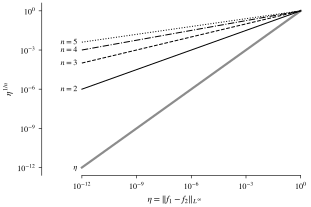
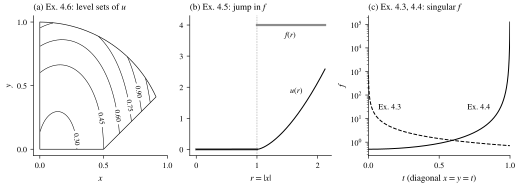
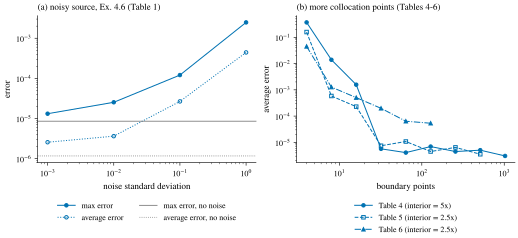
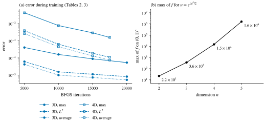

## 引言 \label{sec:intro}

本文精读 Nyström 和 Vestberg 的论文 \cite{nystrom2023}. 它考虑 Monge–Ampère 方程的 Dirichlet 问题

$$
\begin{equation}
  \det D^2 u = f \quad \text{in } \Omega, \qquad u = g \quad \text{on } \partial\Omega,
  \label{eq:dirichlet}
\end{equation}
$$

其中 $\Omega \subset \R^n$ 是有界开凸集, $f \ge 0$ 局部可积, $g$ 连续 (原文 (1.1), 第 2 页). 作者在第 2 页说, 据他们在第 2.2 节的文献回顾, 此前似乎没有用神经网络求解 Monge–Ampère 方程的工作.

这个问题难在两处. 一方面, 算子 $\det D^2 u$ 是完全非线性的, 线性 PDE 的神经网络方法不能直接照搬. 另一方面, \eqref{eq:dirichlet} 的解一般不唯一: 二维时 Rellich 定理只保证至多两个解, 维数为偶数且 $g = 0$ 时, 若 $u$ 是凸解, $-u$ 就是凹解 (原文第 2 页). 应用中需要的是唯一的凸解, 所以数值方法必须保证选中这个解. 我们在 [上一篇文章](../mae-convexity-branch/) 中讨论过这一点: 只含残差和边界项的损失不区分凸解和凹解, 在那篇文章的实验中, 普通 PINN 在 10 个随机种子下都落到了凹解上.

论文的回答是两种处理凸性的试探函数 (ansatz). 第一种是普通的多层感知机 (MLP) 加上惩罚非凸性的损失项, 基本上只适用于二维; 第二种是输入凸神经网络 (input convex neural network, ICNN) \cite{amos2017}, 网络结构本身保证凸性, 适用于任意维数. 论文的主要内容是第二种. 本文按以下顺序介绍: 第 \ref{sec:background} 节给出所用的理论结果, 第 \ref{sec:method} 节介绍两种方法和训练细节, 第 \ref{sec:stability} 节介绍稳定性结果和由它得到的后验误差估计, 第 \ref{sec:experiments} 节逐个介绍实验, 第 \ref{sec:discussion} 节讨论这些结果说明了什么, 没有说明什么.

我们读的是 arXiv 版本 v3 (2023 年 6 月 13 日); 期刊版发表于 *Journal of Computational Mathematics and Data Science* 第 8 卷. 下文的页码, 公式号, 图号和表号都指 arXiv v3.

## 理论背景 \label{sec:background}

对一般的 (不一定光滑的) 凸函数 $v$, 原文按 Figalli \cite{figalli2017} 定义 Monge–Ampère 测度 $Mv(E) := \abs{\partial v(E)}$, 其中 $\partial v(E)$ 是 $v$ 在 $E$ 中各点的次梯度的集合, $\abs{\cdot}$ 是 Lebesgue 测度. 若 $v \in C^2$, 则 $Mv = \det D^2 v \, dx$. 凸函数 $u$ 称为 $\det D^2 u = \mu$ 的 Alexandrov 解, 若 $Mu = \mu$ (原文定义 2.1). 后文用到两个结果.

:::theorem[比较原理]{#thm:comparison}
(原文定理 2.2, 引自 \cite[Theorem 2.10]{figalli2017}) 设 $u, v$ 在有界区域 $\Omega$ 上凸, 在 $\partial\Omega$ 上 $u \le v$. 若在 $\Omega$ 中 $Mu \ge Mv$, 则在 $\Omega$ 中 $u \le v$.
:::

:::theorem[Dirichlet 问题的适定性]{#thm:wellposed}
(原文定理 2.3) 设 $\Omega \subset \R^n$ 是有界严格凸区域, $\mu$ 是 $\Omega$ 上的有界 Borel 测度, $g \in C(\partial\Omega)$. 则 Dirichlet 问题 $\det D^2 u = \mu$ 于 $\Omega$, $u = g$ 于 $\partial\Omega$ 在 $C(\overline\Omega)$ 中有唯一的 Alexandrov 解. 若 $\Omega$ 只是凸的, 只要 $g$ 可以延拓为 $\overline\Omega$ 上的凸函数, 结论仍然成立.
:::

实验中的测试问题都这样构造: 取一个已知的凸函数 $u$, 令 $f := \det D^2 u$, $g := u|_{\partial\Omega}$. 除例 4.5 外, $u$ 都是 $\Omega$ 内的 $C^2$ 函数; 例 4.5 要通过次微分验证 $u$ 是 Alexandrov 解. 凸解的唯一性由定理 \ref{thm:comparison} 得到. 除例 4.4 以外, 存在唯一性也可以由定理 \ref{thm:wellposed} 得到 (原文第 9 页).

## 两种试探函数 \label{sec:method}

两种方法都在配点上最小化方程残差; 区别在于怎样得到凸性, 以及怎样处理边界条件.

### 罚项 MLP: 硬边界条件加凸性罚项

第一种方法沿用 Berg 和 Nyström \cite{berg2018} 处理线性问题的试探函数

$$
\begin{equation}
  u(w, x) = G(x) + D(x) N(w, x),
  \label{eq:hard-bc}
\end{equation}
$$

其中 $G$ 是满足边界条件的光滑函数, $D$ 在区域内为正, 在边界上为零, $N$ 是参数为 $w$ 的深度网络 (原文 (3.1)). 不论 $N$ 取什么, $u$ 都精确满足 Dirichlet 条件, 所以损失只需要管方程. 在单位正方形上, 原文这样构造 $G$ 和 $D$ (第 10 页):

- $G$ 是一个单隐层网络 ($20$ 个神经元, tanh), 用 BFGS 和均方误差拟合 $g$.
- $D$ 是一个单隐层网络 ($40$ 个神经元, tanh), 拟合 $300$ 个随机内部点上的精确距离函数, 以及 $400$ 个边界点上的零值.
- $N$ 有 $5$ 个隐层, 每层 $10$ 个神经元, 激活函数为 sigmoid, 输出层不加激活, 共 $481$ 个参数.

直接最小化残差不能保证得到凸解, 所以原文加了一个凸性罚项. 记 $H = [h_{ij}]$ 为 $2 \times 2$ 对称矩阵, 它的特征值是

$$
\lambda = \frac{h_{11} + h_{22} \pm \sqrt{(h_{11} + h_{22})^2 - 4 \det H}}{2}.
$$

原文 (3.2) 根号内漏了系数 $4$[^typo], 不影响下面的结论. 残差项让 $\det H$ 接近 $f \ge 0$; 在 $\det H \ge 0$ 时, 两个特征值都非负当且仅当 $h_{11} + h_{22} \ge 0$. 另一方面, 半正定矩阵的对角元一定非负. 所以在 $\det H \ge 0$ 的前提下, $H$ 半正定当且仅当 $h_{11} \ge 0$ 且 $h_{22} \ge 0$. 由此得到损失

$$
\begin{align*}
  E_e &= \sum_{j=1}^{M} \bigl( \det D^2 u(x_j, w) - f(x_j) \bigr)^2, \\
  E_c &= \frac{1}{M} \sum_{j=1}^{M} \Bigl( \min\{0, \partial_x^2 u(x_j, w)\}^2 + \min\{0, \partial_y^2 u(x_j, w)\}^2 \Bigr), \\
  E &= E_e + C E_c,
\end{align*}
$$

其中 $\{x_j\}$ 是区域内的配点, $C$ 是一个较大的常数 (原文 (3.3)–(3.5); 原文的 $E_e$ 没有 $1/M$ 因子). 实验中 $C = 10^4$. 原文还试过 Brix 等人的做法, 把残差中的 $\det D^2 u$ 换成 $\max\{0, u_{xx}\} \max\{0, u_{yy}\} - u_{xy}^2$ (原文 (3.6)), 但精度没有提高, 而且原来的行列式收敛所需的迭代次数更少 (第 7 页). 作者猜测这是因为 $C$ 取得较大时, 这个修改的作用就不明显了.

这个罚项有两点局限. 作者自己指出, 它基本上只适用于二维, 因为高维时很难检查特征值的符号 (第 7 页). 上一篇文章中的例子说明了原因: 三维时特征值为 $(5, -1, -1)$ 的矩阵, 行列式和对角元都可以为正, 但它不半正定. 此外, 罚项的论证依赖 $\det D^2 u \ge 0$, 而这个条件只是通过残差近似地满足, 并且只在配点上起作用; 配点之间的凸性没有保证. 上一篇文章中二维的迹罚项 $\min(0, \tr D^2 u)^2$ 也是这个道理, 缺口也一样.

### ICNN: 结构保证凸性, 边界条件用罚项

第二种方法让网络本身对输入凸. 原文 (3.7) 中的 ICNN 为

$$
\begin{equation}
\begin{aligned}
  z_1 &= g_0(L_0 x + b_0), \\
  z_{j+1} &= g_j(W_j z_j + L_j x + b_j), \qquad j = 1, \dots, L-1, \\
  N(\theta, x) &= z_L,
\end{aligned}
\label{eq:icnn}
\end{equation}
$$

其中 $g_j$ 是逐分量作用的单调不减凸函数, $W_j$ 的元素非负, $L_j$ 和 $b_j$ 不受限制. 凸性来自两个事实: 凸函数的非负线性组合是凸的; 凸函数与单调不减凸函数的复合是凸的. 每一层的 $L_j x$ 是从输入直接连过来的项 ("passthrough"), 它对 $x$ 是仿射的, 不影响凸性. 实现上有三个细节 (第 8, 11 页):

- 非负权重写成 $w = v^2$, 对 $v$ 训练.
- 隐层激活函数取 softplus $S(t) = \ln(1 + e^t)$, 它凸, 单调, 光滑, 所以网络也光滑, 二阶导数可以用自动微分计算. 原文第 6 节的 (6.9) 写出了实际用的形式: 最后一层是仿射的 $W_N z_N + L_N x + b_N$, 不加激活, 以免限制输出的取值范围.
- 网络有 $5$ 个隐层, 每层 $10$ 个神经元, 共 $563$ 个参数.

这里有一个凸性和边界条件之间的冲突. 即使 \eqref{eq:hard-bc} 中的 $G, D, N$ 都取凸网络, 乘积 $DN$ 一般也不凸, 所以 ICNN 不能再用硬边界条件 (第 8 页). 原文改用边界罚项:

$$
\begin{align*}
  E_b &= \frac{1}{K} \sum_{k=1}^{K} \bigl( u(y_k, w) - g(y_k) \bigr)^2, \\
  E &= E_e + C E_b,
\end{align*}
$$

其中 $\{y_k\} \subset \partial\Omega$ (原文 (3.8)). 凸性罚项不再需要, 代价是边界条件只能近似满足.

### 训练细节

所有导数 (包括 Hessian 和损失对参数的梯度) 都用 TensorFlow 自动微分计算. 优化器主要是 SciPy 的 BFGS, 它只用函数值和一阶导数, 当梯度的欧氏范数小于 $10^{-5}$ (SciPy 默认值) 时停止 (第 8 页). 作者还自己实现了 Adam. 参数按正态分布随机初始化. 配点用 `numpy.random.uniform` 均匀采样: 正方形内部直接采样; 边界上的线段由 $[0,1)$ 上的点仿射映射得到; 例 4.6 中的圆弧用三角参数化, 内部点在单位正方形中采样后舍去区域外的点 (第 8–9 页).

BFGS 的一个反复出现的问题是因精度损失 (precision loss) 而提前停止, 即线搜索失败. 原文的处理办法是 "Adam 重启": 停下后改用 Adam 训练一段, 离开出问题的区域后再换回 BFGS. 在例 4.1 中, 这一段是几百个 epoch, 学习率在 $10^{-7}$ 量级 (第 10 页); 例 4.4 和五维的例子中也用了这个办法 (第 \ref{sec:experiments} 节).

## 稳定性与后验误差估计 \label{sec:stability}

论文的理论部分 (第 6 节) 不讨论训练能否收敛, 而是回答另一个问题: 如果已经得到一个凸函数, 它近似满足方程和边界条件, 它离真解有多远?

:::proposition[稳定性]{#prop:stability}
(原文命题 6.1) 设 $u_1, u_2 \in C(\overline\Omega)$ 是有界区域 $\Omega \subset \R^n$ 上的凸函数, 分别 (在 Alexandrov 意义下) 满足 $\det D^2 u_j = f_j$ 于 $\Omega$, $u_j = g_j$ 于 $\partial\Omega$, 其中 $f_j \in L^1(\Omega; [0, \infty))$, $g_j \in C(\partial\Omega)$, $j = 1, 2$. 又设 $\|f_1 - f_2\|_{L^\infty(\Omega)} < \infty$. 则

$$
\begin{equation}
  \|u_1 - u_2\|_{L^\infty(\Omega)} \le \sup_{x \in \partial\Omega} \abs{g_1(x) - g_2(x)} + C_n \diam(\Omega) \abs{\Omega}^{1/n} \|f_1 - f_2\|_{L^\infty(\Omega)}^{1/n},
  \label{eq:stability}
\end{equation}
$$

其中 $C_n$ 只依赖于维数.
:::

:::proof[证明思路]
记 $\eta = \|f_1 - f_2\|_{L^\infty}$, $\varepsilon = \sup_{\partial\Omega} \abs{g_1 - g_2}$. 设 $w$ 是右端项为 $f_1 + \eta$, 边界值为 $g_1 - \varepsilon$ 的凸解, 由比较原理 $u_2 \ge w$. 再设 $v$ 是右端项为常数 $\eta$, 边界值为零的凸解. 由 Monge–Ampère 测度的超可加性 $M(u_1 + v) \ge Mu_1 + Mv$ (原文命题 A.2), 再用一次比较原理, 得到 $u_2 \ge u_1 + v - \varepsilon$. 最后由 Alexandrov 最大值原理 (原文定理 A.1) 估计 $\abs{v}^n \le \tfrac{c_n}{2} \diam(\Omega)^n \eta \abs{\Omega}$. 交换 $u_1$ 和 $u_2$ 即得 \eqref{eq:stability}, 其中 $C_n = (c_n / 2)^{1/n}$, $c_n$ 是 Alexandrov 最大值原理中的常数.
:::

命题的叙述只要求 $\Omega$ 有界, 但证明中用到的原文定理 A.1 是对有界凸区域叙述的, 证明还要用定理 \ref{thm:wellposed} 保证 $w$ 和 $v$ 存在. 我们认为应当把命题读作有界凸区域上的结论; 这与 \eqref{eq:dirichlet} 的设定一致.

命题 \ref{prop:stability} 怎样用于误差估计? 设 $u$ 是 \eqref{eq:dirichlet} 的 (未知) 解, $v$ 是一个已知的光滑凸函数, 例如训练好的 ICNN. 那么 $v$ 本身是右端项 $f_v := \det D^2 v$, 边界值 $g_v := v|_{\partial\Omega}$ 的 Dirichlet 问题的解. 由 \eqref{eq:stability}, $\|u - v\|_{L^\infty}$ 被 $\sup_{\partial\Omega} \abs{g - g_v}$ 和 $\|f - f_v\|_{L^\infty}^{1/n}$ 控制, 而这两个量只涉及已知的函数. 剩下的问题是, 损失只在有限个点上计算残差, 而 \eqref{eq:stability} 要的是上确界. 原文用 Lipschitz 常数填上这个空隙.

:::lemma[后验误差估计]{#lem:aposteriori}
(原文引理 6.2) 设 $u$ 是 \eqref{eq:dirichlet} 的解, $f$ 和 $g$ Lipschitz 连续, $v \in C^3(\overline\Omega)$ 凸. 取点 $\{x_j\}_{j=1}^M \subset \Omega$, $\{y_k\}_{k=1}^N \subset \partial\Omega$ 和 $r, s > 0$, 使得 $\Omega \subset \bigcup_j B(x_j, r)$, $\partial\Omega \subset \bigcup_k B(y_k, s)$. 则

$$
\begin{aligned}
  \|u - v\|_{L^\infty(\Omega)} \le{} & C_n \diam(\Omega) \abs{\Omega}^{1/n} \Bigl( (\Lip f + \Lip f_v) r + \max_{j} \abs{f(x_j) - f_v(x_j)} \Bigr)^{1/n} \\
  & + (\Lip g + \Lip g_v) s + \max_{k} \abs{g(y_k) - g_v(y_k)},
\end{aligned}
$$

其中 $C_n$ 是命题 \ref{prop:stability} 中的常数.
:::

右端除 $\Lip f_v$ 和 $\Lip g_v$ 外都可以由有限次函数求值得到. 对这两个常数, 原文先说明只需 $v$ 的三阶以内导数的界: 由 $\partial_k \det H = \tr(\adj H \, \partial_k H)$, 其中 $H = D^2 v$, 可得

$$
\abs{\nabla f_v} \le \sqrt{n}\, n\, (n!) \Bigl( \sup_{x \in \Omega, \abs{\alpha} = 2} \abs{\partial^\alpha v} \Bigr)^{n-1} \sup_{x \in \Omega, \abs{\beta} = 3} \abs{\partial^\beta v}
$$

(原文 (6.8)). 然后, 原文引理 6.3 对 softplus ICNN 给出了一阶, 二阶, 三阶导数的显式上界. 这些界只依赖于权重: 用 $\abs{L_j}$ 表示逐元素取绝对值, 递推地定义非负矩阵 $M_0 = \abs{L_0}$, $M_p = \abs{L_p} + W_p M_{p-1}$, 则 $\abs{\partial_k v} \le M_N(k)$; 二阶和三阶导数的界是 $W_N \cdots W_j$ 与 $M_{j-1}$ 的元素乘积之和. 证明只用到 softplus 的 $\abs{S'}, \abs{S''}, \abs{S'''} \le 1$ 和链式法则. 把这些界代入引理 \ref{lem:aposteriori}, 就得到一个不需要真解, 只需有限次函数求值的 $L^\infty$ 误差上界.

这个估计只适用于凸的近似解. 命题 \ref{prop:stability} 要求 $u_1, u_2$ 都凸, 所以它覆盖 ICNN, 不覆盖罚项 MLP: 后者只在配点上近似凸. 这是 ICNN 方法在理论上的一个好处.

此外, 残差项的指数为 $1/n$, 这个界相当悲观. 图 \ref{fig:stability} 画出了 $\eta^{1/n}$. 二维时, 残差的上确界即使为 $10^{-6}$, 误差项仍有 $C_2 \diam(\Omega) \abs{\Omega}^{1/2} \cdot 10^{-3}$; 四维时要让 $\eta^{1/4}$ 降到 $10^{-3}$, 残差的上确界要到 $10^{-12}$. 除非 $C_n$ 很小, 这样的界比第 \ref{sec:experiments} 节中 $10^{-5}$ 量级的实际误差大得多. $C_n$ 来自 Alexandrov 最大值原理, 原文没有给出它的数值.

原文也没有在任何一个实验上计算这个上界. 我们因此不知道, 对实际训练出的网络, 由原文引理 6.3 得到的 $\Lip f_v$ 有多大, 覆盖半径 $r$ 要取多小, 上界和真实误差差几个数量级. 作者在结论中也把改进 Lipschitz 常数的界列为以后的工作 (第 27 页).

:::figure{#fig:stability .invert-dark}

稳定性估计 \eqref{eq:stability} 中残差项的因子 $\eta^{1/n}$, 由公式直接计算. 黑色实线, 虚线, 点划线和点线依次对应 $n = 2, 3, 4, 5$; 灰色宽实线是线性的 $\eta$, 作为对照.
:::

## 数值实验 \label{sec:experiments}

原文第 4 节有七个例子, 第 5 节研究配点数量的影响. 例 4.1 用罚项 MLP, 其余都用 ICNN. 表 \ref{tab:examples} 汇总了各例的设置, 图 \ref{fig:problems} 画出了其中几个测试问题. 原文只报告了第 4.6, 4.7 节和第 5.3 节的误差表格; 第 4 节其余的二维例子只给了绝对误差的热图, 下文引用热图的数字时, 指的是图中色标的最高刻度, 只说明量级.

:::table{#tab:examples}
| 例 | 区域 | 精确解或特点 | 方法 | 内部点 / 边界点 | 权重 | 迭代 |
| :-- | :-- | :-- | :-- | --: | :-- | :-- |
| 4.1 | $(0,1)^2$ | $e^{(x^2+y^2)/2}$, 光滑 | 罚项 MLP | $3000$ / $400$ | $C = 10^4$ | BFGS + Adam 重启 |
| 4.2 | $(0,1)^2$ | 同上 | ICNN | $3000$ / $400$ | $C = 100$ | BFGS, $2287$ 次收敛 |
| 4.3 | $(0,1)^2$ | $f$ 在原点 (边界上) 奇异, 可积 | ICNN | 未说明; 另加 $40$ 个 | $C = 1000$, $K = 4000$ | $55000$ 次 |
| 4.4 | $(0,1)^2$ | $f$ 在 $(1,1)$ 奇异, 不可积 | ICNN | 未说明; 另加 $40$ 个 | $C = 1000$, $K = 4000$ | BFGS + Adam |
| 4.5 | $(0, 1.5)^2$ | $f$ 在 $r = 1$ 间断 | ICNN | $3000$ / $400$; $10^4$ / $1000$ | 未说明 | 见正文 |
| 4.6 | 非对称凸区域 | 无对称性; $f$ 加噪声 | ICNN | $3000$ / $400$ | 未说明 | $5000$; 至多 $10^4$ |
| 4.7 | $(0,1)^n$, $n = 3,4,5$ | $e^{\abs{x}^2/2}$ | ICNN | 见正文 | 未说明 | 见正文 |

各例的设置, 取自原文第 4 节 (第 9–17 页). "另加 $40$ 个" 指奇点附近两条边上各 $20$ 个边界点, 权重为 $K$; 例 4.3 和 4.4 只说沿用例 4.2 的方法, 没有重述配点数. "未说明" 指原文没有给出这一项.
:::

:::figure{#fig:problems .invert-dark}

四个测试问题, 由原文给出的公式计算. (a) 例 4.6 的区域 ($x > 0$, $y > 0$, $x^2 + y^2 < 1$, $y > x - \tfrac12$, 黑色外框) 和精确解的等值线 (黑色细线, 数字为 $u$ 的值; 圆弧下角上未标数字的一条为 $1.05$). (b) 例 4.5 的径向剖面: $u$ (黑色实线) 在 $r \le 1$ 上为零, $C^1$ 地接上外侧的部分, 右端项 $f$ (灰色宽实线) 在 $r = 1$ (灰色点线) 处从 $0$ 跳到 $4$. (c) 例 4.3 (黑色虚线) 和例 4.4 (黑色实线) 的右端项在对角线上的取值, 奇点分别在原点和 $(1,1)$, 都在边界上.
:::

### 二维光滑问题: 两种方法的对比

例 4.1 和例 4.2 解同一个问题: 在 $\Omega = (0,1)^2$ 上,

$$
u(x, y) = \exp\Bigl( \frac{x^2 + y^2}{2} \Bigr), \qquad f(x, y) = (1 + x^2 + y^2) \exp(x^2 + y^2)
$$

(原文 (4.1), (4.2)). 两者都用 $3000$ 个随机内部点和 $400$ 个边界点. 罚项 MLP 取 $C = 10^4$, 训练中 BFGS 因精度损失停止过, 用 Adam 重启后继续. 它的绝对误差热图 (原文图 1) 的色标最高刻度为 $0.0054$. ICNN 取 $C = 100$, 残差项 $E_e$ 中也包含边界点; BFGS 在 $2287$ 次迭代后收敛, 绝对误差热图 (原文图 2) 的色标最高刻度为 $2.97 \times 10^{-5}$. 作者的概括是, 罚项 MLP 的误差在 $10^{-3}$ 量级, ICNN 在 $10^{-5}$ 量级 (第 11 页). 由于 $u$ 在单位正方形上是 $1$ 的量级, 相对误差也是这个量级. 作者还说, 罚项 MLP 的精度与 \cite{berg2018} 中例子的精度相当.

两个数量级的差距很醒目, 但这次对比没有控制以下几个因素: 两个网络的结构不同 (sigmoid MLP 有 $481$ 个参数, softplus ICNN 有 $563$ 个); 罚项权重不同 ($10^4$ 对 $100$); 前者精确满足边界条件, 后者只近似满足; 前者的训练中间插入了 Adam; 每种方法只报告了一次运行, 没有不同随机种子下的统计, 也没有计算时间. 这个结果说明 ICNN 在这个问题上能达到很高的精度, 但不能把两个数量级全部归因于 "结构凸性比罚项好".

### 边界上的奇性

例 4.3 取

$$
u(x, y) = \frac{2\sqrt2}{3} (x^2 + y^2)^{3/4}, \qquad f(x, y) = \frac{1}{(x^2 + y^2)^{1/2}},
$$

$f$ 在原点奇异, 原点在 $\Omega = (0,1)^2$ 的边界上, 但 $f$ 可积 (第 11–12 页). 例 4.2 的方法在这里也能用, 但作者发现在奇点附近多放边界点并加大权重效果更好. 损失改为

$$
\begin{align*}
  E &= E_e + C E_b + K E_B, \qquad E_B = \frac{1}{P} \sum_{k=1}^{P} \bigl( u(z_k, w) - g(z_k) \bigr)^2,
\end{align*}
$$

其中 $z_k$ 是线段 $[0, 0.04] \times \{0\}$ 和 $\{0\} \times [0, 0.04]$ 上各 $20$ 个等距点, $C = 1000$, $K = 4000$ (原文 (4.3)). 加上 $E_B$ 后, $5000$ 次迭代时的绝对误差已经小于不加这一项时所能得到的最好结果, 最大误差减小了 $90\%$ 以上. $55000$ 次迭代后的误差热图 (原文图 3) 的色标最高刻度为 $9 \times 10^{-5}$.

例 4.4 取球面的一部分,

$$
u(x, y) = -\sqrt{2 - x^2 - y^2}, \qquad f(x, y) = \frac{2}{(2 - x^2 - y^2)^2},
$$

$f$ 在角点 $(1,1)$ 处奇异, 奇性强于例 4.3, 并且不可积 (第 12–13 页), 定理 \ref{thm:wellposed} 不能用, 唯一性靠精确解加比较原理得到. 训练沿用例 4.3 的 $C$ 和 $K$, 额外的边界点放在 $[0.95, 1] \times \{1\}$ 和 $\{1\} \times [0.95, 1]$ 上, 各 $20$ 个. BFGS 多次因精度损失停止, 作者认为这很可能是右端项的强奇性造成的; 每次用 Adam 迭代几步后继续. 最终的误差热图 (原文图 4) 的色标最高刻度为 $1.8 \times 10^{-4}$; 从图上看, 最大误差出现在右边界 $x = 1$ 上靠近奇点 $(1,1)$ 的地方.

### 间断的右端项

例 4.5 在 $\Omega = (0, 1.5)^2$ 上取径向函数

$$
u(r) = \begin{cases} 0, & r \le 1, \\ r\sqrt{r^2 - 1} - \ln\bigl(r + \sqrt{r^2 - 1}\bigr), & r > 1, \end{cases}
\qquad
\partial_r u(r) = \begin{cases} 0, & r \le 1, \\ 2\sqrt{r^2 - 1}, & r > 1. \end{cases}
$$

$u$ 是 $C^1$ 的. 由径向函数的 $\det D^2 u = \tfrac1r (\partial_r u)(\partial_r^2 u)$, 除 $r = 1$ 外 $f = 0$ ($r < 1$) 或 $f = 4$ ($r > 1$); $r = 1$ 上的点对 Monge–Ampère 测度没有贡献, 所以 $u$ 是右端项为 (4.4) 的 Alexandrov 解 (第 13 页). 这是唯一一个解在 $\Omega$ 内不是 $C^2$ 的例子.

网络结构与例 4.2 相同. 用 $3000$ 个内部点和 $400$ 个边界点时, 误差热图 (原文图 5) 的色标最高刻度为 $0.00162$, 比前面的例子差得多, 最大误差出现在间断线 $r = 1$ 附近. 作者先试着在 $r = 1$ 附近加密配点, 发现这会妨碍训练; 他们的解释是, 单位圆两侧离得很近的点要映到很不同的值 ($4$ 和 $0$). 改为在整个区域加密, 用 $10000$ 个内部点和 $1000$ 个边界点后, 最大误差降到原来的一半以下 (原文图 6, 色标最高刻度 $0.00072$), 但仍比前面的例子大. 关于迭代次数, 正文写的是 $15000$ 次, 原文图 5 和图 6 的图注写的是 $150000$ 次 (第 14–15 页), 我们无法判断哪个是对的. [TODO: 核对期刊版 (JCMDS 8, 100080) 中例 4.5 的迭代次数]

### 非对称区域与噪声

例 4.6 的区域由 $x > 0$, $y > 0$, $x^2 + y^2 < 1$, $y > x - \tfrac12$ 围成 (图 \ref{fig:problems}a), 精确解

$$
u(x, y) = \tfrac{7}{10} \exp\Bigl( \tfrac12 \bigl( (x - \tfrac12)^2 + y^2 \bigr) \Bigr) + x^2 - \tfrac12
$$

是作者随意选的, 没有特别的对称性 (第 15 页). 用 $3000$ 个内部点和 $400$ 个边界点, 每段边界上的点数大致与其长度成正比. BFGS 迭代 $5000$ 次后, 无噪声情形的误差热图 (原文图 7) 的色标最高刻度为 $8.1 \times 10^{-6}$.

然后作者在右端项的值上加正态分布的噪声, 标准差从 $10^{-3}$ 到 $1$, 每种情形用 BFGS 训练到收敛或至多 $10000$ 次迭代, 在 $10^6$ 个随机内部点上计算最大误差和平均误差 (原文表 1). 结果见图 \ref{fig:noise}a. 无噪声时最大误差为 $8.58 \times 10^{-6}$, 平均误差为 $1.17 \times 10^{-6}$; 标准差为 $10^{-3}$ 和 $10^{-2}$ 时, 最大误差为 $1.32 \times 10^{-5}$ 和 $2.54 \times 10^{-5}$, 作者认为这一段精度变化不大; 标准差为 $10^{-1}$ 和 $1$ 时, 最大误差为 $1.21 \times 10^{-4}$ 和 $2.48 \times 10^{-3}$. 作者的结论是方法对噪声 "相当稳定", 但也说明每次运行的数值会有一些变化, 总的趋势是噪声降低精度. 我们补充两点. 标准差从 $0.1$ 增大到 $1$ 时, 最大误差增大约 $20$ 倍, 平均误差增大约 $17$ 倍, 大于标准差的增幅. 另外, 原文没有说明噪声在训练中是固定的还是每次重新抽取, 也没有给出多次运行的统计.

:::figure{#fig:noise .invert-dark}

蓝色曲线都是 ICNN 的结果; (b) 中的网络是我们推断的, 见下文. (a) 例 4.6 中右端项加正态噪声后的误差: 实线实心圆为最大误差, 点线空心圆为平均误差; 灰色水平实线和点线是无噪声时的两个值 (标准差 $0$ 在对数轴上画不出来); 数据取自原文表 1. (b) 同时加倍边界点和内部点时的平均误差, 内部点数是边界点数的 $5$ 倍 (表 4, 实线实心圆) 或 $2.5$ 倍 (表 5, 虚线空心方块; 表 6, 点划线实心三角); 数据取自原文表 4–6, 每次至多 $5000$ 次 BFGS 迭代. 表 6 中印作 "1.27-03" 的值按 $1.27 \times 10^{-3}$ 画出.
:::

### 高维

例 4.7 把例 4.2 推广到 $(0,1)^n$ 上的 $u = \exp(\abs{x}^2/2)$. 原文没有单独说明高维时的网络结构, 也没有写出 $n$ 维的右端项; 由径向函数的公式 $\det D^2 u = (\partial_r u / r)^{n-1} \partial_r^2 u$, 我们算得 $f = (1 + \abs{x}^2) e^{n\abs{x}^2/2}$.

- 三维时用 $4000$ 个内部点, $1200$ 个边界点, BFGS 在 $20015$ 次迭代后正常停止. 最终的最大误差为 $5.333 \times 10^{-5}$, 平均误差为 $5.250 \times 10^{-6}$, $L^2$ 误差为 $8.123 \times 10^{-6}$ (原文表 2).
- 四维时用 $4000$ 个内部点, $2400$ 个边界点, BFGS 在 $17506$ 次迭代后因精度损失停止. 此时最大误差为 $1.553 \times 10^{-3}$, 平均误差为 $7.387 \times 10^{-5}$, $L^2$ 误差为 $1.090 \times 10^{-4}$ (原文表 3).
- 五维时训练失败. BFGS 一开始就因精度损失停止; 只用 Adam 时损失有所下降, 但非常慢. 作者找到的唯一可行的流程是: (1) 用 Adam 只最小化边界损失 $E_b$, 至多 $1000$ 个 epoch; (2) 用 Adam 最小化完整损失几千个 epoch, 这一步在有 (1) 时下降快得多; (3) 换成 BFGS, 损失迅速下降, 然后又因精度损失停止; (4) 交替使用 Adam 和 BFGS. Adam 用全部配点作为一个 batch 时效率最高. 损失的初值在 $10^7$ 量级, 可以较快降到 $1$ 的量级, 之后收敛变慢; 这时近似解与精确解仍有明显差别. 原文没有报告五维的误差数字, 只说需要进一步改进方法 (第 16–17 页).

图 \ref{fig:dimension}a 画出了三维和四维的误差随迭代次数的变化. 四维最终的 $L^2$ 误差约为三维的 $13$ 倍, 最大误差约为三维的 $29$ 倍; 四维的训练没有正常结束, 所以这个比较对四维稍有不利. 五维为什么失败, 原文没有分析. 图 \ref{fig:dimension}b 是我们自己的一个观察, 不是原文的内容: 在 $(0,1)^n$ 上, $f$ 的最小值为 $1$ (在原点), 最大值为 $(1 + n) e^{n^2/2}$ (在角点 $(1, \dots, 1)$), 五维时约为 $1.6 \times 10^6$. 右端项的尺度随维数这样增长, 可能是五维损失初值很大, BFGS 一开始就失败的原因之一; 这只是我们的猜测, 要验证需要把同样的网络用在一个 $f$ 尺度不随维数增长的问题上.

:::figure{#fig:dimension .invert-dark}

(a) 三维和四维 ICNN (蓝色) 的误差随迭代次数的变化. 线型区分误差: 实线为最大误差, 虚线为 $L^2$ 误差, 点线为平均误差; 标记区分维数: 实心圆为三维, 空心方块为四维. 数据取自原文表 2 和表 3 (表 3 中印作 "7.387-05" 的值按 $7.387 \times 10^{-5}$ 画出). 五维训练失败, 原文没有误差数字. (b) 我们由公式算出的 $u = e^{\abs{x}^2/2}$ 的右端项在 $(0,1)^n$ 上的最大值 (黑色实线, 圆点为各个 $n$, 旁边标出数值), 最小值恒为 $1$.
:::

### 配点数量的影响

原文第 5 节在三个问题上研究配点数量的影响: 例 4.1 的问题, 例 4.3 的问题, 以及 (4.1) 中的函数在单位圆盘上的问题. 为了把边界点和内部点的作用分开, 这里的 $E_e$ 只包含内部点. 原文没有说明这一节用的是哪种网络; 由于边界点只通过 $E_b$ 进入损失, 我们推断是 ICNN. 每次计算都用 BFGS 训练到收敛或至多 $5000$ 次迭代.

- 固定 $400$ 个边界点, 内部点从 $4$ 或 $5$ 个开始逐次加倍 (原文图 8–10).
- 固定 $1000$ 个内部点, 边界点从 $4$ 个开始逐次加倍 (原文图 11–13).
- 边界点和内部点同时加倍 (原文表 4–6, 图 \ref{fig:noise}b).

三组实验的趋势一致: 平均误差先随点数快速下降, 降到一定程度后变慢, 并有一些振荡. 以原文表 4 为例, $4$ 个边界点和 $20$ 个内部点时平均误差为 $0.368$, $32$ 个边界点和 $160$ 个内部点时已降到 $5.69 \times 10^{-6}$, 之后一直在 $3 \times 10^{-6}$ 到 $7 \times 10^{-6}$ 之间, 最后一行 ($1024$ / $5120$) 为 $3.05 \times 10^{-6}$. 表 6 的下降较慢, $128$ / $320$ 时为 $5.36 \times 10^{-5}$. 作者认为, 点数较多时误差不再下降, 主要是因为 $5000$ 次的迭代上限常常在优化正常结束之前就到了; 他们验证过增加迭代次数可以提高精度. 另外, 只增加一类点会改变两类点的比例, 这也可能妨碍收敛 (第 19–20 页). 这一节说明的是 "只用很少的配点就能得到相当好的结果", 而不是一个收敛阶.

这一节有一处我们无法核对的不一致: 正文说表 4, 5, 6 依次对应例 4.1, 例 4.3 和圆盘上的问题, 但表 4 和表 5 的表注都写着圆盘上的问题, 表 6 的表注写着例 4.3 (第 18, 21 页). 图 \ref{fig:noise}b 因此只按表号标注. [TODO: 核对期刊版中表 4–6 的表注]

## 讨论 \label{sec:discussion}

这篇论文说明了以下几点. ICNN 是一个可用的凸试探函数: 在二维光滑问题上, $563$ 个参数的网络就能达到 $10^{-5}$ 量级的绝对误差; 对边界上的奇点, 在奇点附近加边界点和权重可以较大地改善精度; 方法能处理非对称的凸区域, 对右端项的小噪声不敏感; 三维和四维也能得到较好的结果. 理论上, 命题 \ref{prop:stability} 和引理 \ref{lem:aposteriori} 给出了一条不需要真解的 $L^\infty$ 误差估计路线, 而这条路线只对凸的近似解成立, 这正是 ICNN 相对罚项方法的一个优势.

论文没有回答的问题主要有以下几点:

1. 两种方法只在一个二维问题上对比过一次, 而且网络, 权重, 边界处理和优化过程都不同 (第 \ref{sec:experiments} 节). 原文也没有和任何经典方法对比; 作者明确说没有复现 Benamou, Froese 和 Oberman \cite{benamou2010} 在同样几个二维问题上的方法 (第 9 页).
2. 所有结果都是单次运行. 作者承认结果会随随机配点和随机初始化变化, 但没有给出方差. 原文也没有报告任何计算时间, 只在结论中定性地说, 点数增加时每次迭代的时间增加不多, 但所需的 BFGS 迭代次数会增加 (第 27 页).
3. 后验误差估计没有在任何实验上算出数值, 而 $1/n$ 的指数使它在高维时很弱.
4. 五维的训练失败没有分析. 训练依赖 BFGS 与 Adam 交替的人工调度, 何时切换, 学习率取多大, 原文只给了个别例子的设置.
5. 二维以外, 罚项 MLP 没有凸性保证; 二维时它的凸性也只在配点上近似成立. 原文没有报告训练出的罚项 MLP 在配点之间是否凸.
6. ICNN 的边界条件只是近似满足. 从原文的热图看, 不少例子的最大误差出现在边界附近 (例如原文图 2, 3, 4, 7), 这是我们的读图结果, 原文没有讨论.

作者在结论中列出的后续工作包括: 推广到 $\det D^2 u = f(x, u, \nabla u)$, 特别是给定 Gauss 曲率问题和最优传输问题 (后者的边界条件涉及梯度把边界映到边界); 比较深网络和浅网络; 估计和减少计算时间; 改进第 6 节中 Lipschitz 常数的界 (第 27 页).

## 小结

Nyström 和 Vestberg 用两种试探函数求解 Monge–Ampère 方程的 Dirichlet 问题. 罚项 MLP 用硬边界条件加 Hessian 对角元罚项促使凸性, 基本上只适用于二维; ICNN 由结构保证凸性, 边界条件改用罚项, 适用于任意维数. 在作者的例子中, ICNN 在二维光滑问题上的误差在 $10^{-5}$ 量级, 能处理边界奇点, 间断右端项 (精度较差), 非对称区域和带噪声的右端项, 在三维和四维也有效, 五维训练失败. 理论上, Alexandrov 解的稳定性给出了凸近似解的后验 $L^\infty$ 误差估计, 但它的收敛速度只有残差的 $1/n$ 次方, 原文也没有在实验中使用它. 作为 (据作者所知) 第一篇这类工作, 它提出了 "凸结构加残差损失" 这条路线; 留下的问题是缺少对照, 高维训练不稳定, 以及理论界和实际误差之间的距离.

[^typo]: $2 \times 2$ 对称矩阵的特征值满足 $\lambda^2 - (h_{11} + h_{22})\lambda + \det H = 0$, 判别式为 $(h_{11} + h_{22})^2 - 4\det H$.
