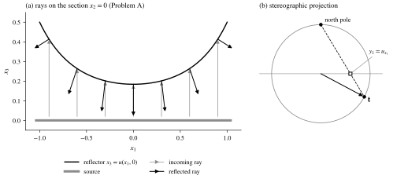
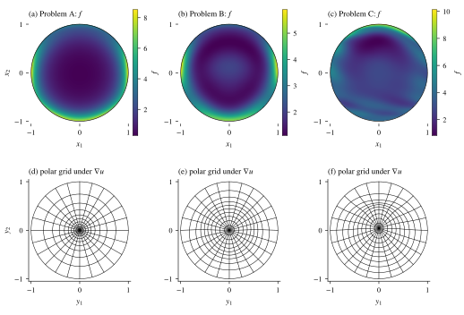
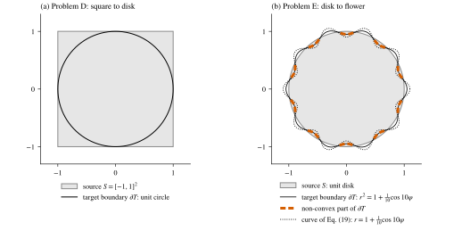
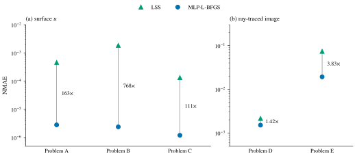

## Introduction \label{sec:intro}

A classical problem in illumination optics is to design a mirror that turns a given light source into a prescribed light distribution. The problem is an instance of optimal transport, with energy playing the role of mass and optical path length the role of cost \cite{hacking2025}, and it leads to the Monge–Ampère equation with the *transport boundary condition*. On the one hand, the established solvers for this problem (finite differences \cite{froese2012}, finite elements, and the least-squares method of Prins et al. \cite{prins2015}) are tailored to it, and, as the paper argues, each new optical system needs new update rules. On the other hand, neural solvers that minimize the residual of the equation (the PINN family) are generic: a new equation only needs a new loss. Nyström and Vestberg \cite{nystrom2023} used this approach for the Dirichlet problem of the Monge–Ampère equation; according to the authors of the paper discussed here, no neural method had handled the transport boundary condition before.

The paper of Hacking, Kusch, Mitra, Anthonissen and IJzerman \cite{hacking2025} fills this gap. The reflector surface is a multilayer perceptron (MLP), the loss combines the residual, a boundary term and a convexity penalty, the optimizer is L-BFGS, and the method is compared with the least-squares solver on five test problems. This post goes through the paper in detail. Section \ref{sec:optics} derives the equation from the optics and explains why it is hard. Section \ref{sec:theory} collects the relevant theory; the paper itself has no theorems, so we state the classical results that its formulation relies on and point out which test problems fall outside them. Section \ref{sec:method} describes the loss, the network, the sampling and the optimizer. Section \ref{sec:exp} goes through every experiment and its numbers, and Section \ref{sec:discussion} discusses what the results do and do not show.

## The parallel-to-far-field reflector problem \label{sec:optics}

### Geometry and the law of reflection

The paper considers one optical configuration, the parallel-to-far-field reflector \cite{hacking2025}. A planar source occupies a region $S \subset \R^2$ of the plane $x_3 = 0$ and emits light upward in the direction $\mathbf{s} = (0, 0, 1)^\top$ with intensity $f: S \to \R$. Above it sits a perfect mirror of height $x_3 = u(x_1, x_2)$. A ray leaving $(x_1, x_2, 0)$ is reflected at $(x_1, x_2, u(x_1, x_2))$ into the direction

$$
\mathbf{t} = \mathbf{s} - 2 (\mathbf{s} \cdot \mathbf{n}) \mathbf{n},
$$

where $\mathbf{n}$ is the unit normal of the surface. In the far field the mirror is small compared with the distance the light travels, so all reflected rays can be treated as leaving from one point and are distinguished only by their direction $\mathbf{t}$, a point on the unit sphere. The paper represents $\mathbf{t}$ by stereographic projection from the north pole, which gives plane coordinates $\by = (y_1, y_2)$, and prescribes the target distribution $g$ in these coordinates, with support the target region $T$.

The paper states without derivation that, by the law of reflection, the gradient of $u$ equals the stereographic coordinates of the reflected ray. This takes three lines to check. With $\mathbf{p} = \nabla u$ we have $\mathbf{n} = (-\mathbf{p}, 1) / \sqrt{1 + \abs{\mathbf{p}}^2}$ and $\mathbf{s} \cdot \mathbf{n} = 1/\sqrt{1 + \abs{\mathbf{p}}^2}$, so

$$
\mathbf{t} = \Bigl( \frac{2\mathbf{p}}{1 + \abs{\mathbf{p}}^2}, \ \frac{\abs{\mathbf{p}}^2 - 1}{1 + \abs{\mathbf{p}}^2} \Bigr).
$$

Stereographic projection from $(0, 0, 1)$ sends $\mathbf{t}$ to $\by = (t_1, t_2)/(1 - t_3)$, and $1 - t_3 = 2/(1 + \abs{\mathbf{p}}^2)$, hence

$$
\by = \nabla u(\bx).
$$

The gradient of the mirror tells each ray where to go, which is why the paper calls $\nabla u$ the "mapping" of the reflector. Figure \ref{fig:geometry} shows both steps.

:::figure{#fig:geometry .invert-dark}

(a) The section $x_2 = 0$ of the reflector $u = e^{\abs{\bx}^2}/(2e)$ of Problem A (black solid line). Thin grey arrows are vertical rays from the source (thick grey line), black arrows the reflected directions given by the law of reflection. (b) The reflected direction $\mathbf{t}$ (black arrow from the center of the grey unit circle) projected from the north pole onto the horizontal plane (grey horizontal line): the black dashed line runs from the north pole through the projected point (open square) to $\mathbf{t}$, and the projected point has coordinate $u_{x_1}$. Both panels are drawn from the formulas.
:::

### The Monge–Ampère equation and the transport boundary condition

Energy conservation says that for every subset $E \subset S$ the energy leaving $E$ arrives in $\nabla u(E)$: $\int_E f \,\mathrm{d}\bx = \int_{\nabla u(E)} g \,\mathrm{d}\by$. If $\nabla u$ is smooth and injective, the change of variables $\by = \nabla u(\bx)$ on the right and the arbitrariness of $E$ give $\abs{\det D^2 u} = f / g(\nabla u)$; on the convex branch (see below) the absolute value can be dropped:

$$
\begin{equation}
  \det D^2 u(\bx) = \frac{f(\bx)}{g(\nabla u(\bx))}, \qquad \bx \in S,
  \label{eq:mae}
\end{equation}
$$

which is Eq. (2a) of the paper. The paper's argument is that since $f > 0$, the determinant is positive everywhere, so $u$ is either strictly convex or strictly concave; the paper takes the convex branch. All light must also land in the target, $\nabla u(S) = T$. The paper argues that for convex $u$ the gradient is a diffeomorphism, so this condition reduces to a condition on the boundary only,

$$
\begin{equation}
  \nabla u(\partial S) = \partial T,
  \label{eq:tbc}
\end{equation}
$$

the transport boundary condition \cite{froese2012}. The paper also notes that the parallel-to-parallel reflector and the parallel-to-far-field lens lead to the same mathematical problem, so the method covers them as well \cite{hacking2025}.

Integrating \eqref{eq:mae} over $S$ and using $\nabla u(S) = T$ shows a hidden compatibility condition: $\int_S f \,\mathrm{d}\bx = \int_T g \,\mathrm{d}\by$, that is, the source and the target carry the same total energy. Besides, \eqref{eq:mae} and \eqref{eq:tbc} only involve derivatives of $u$, so $u$ is determined at most up to an additive constant. This matters for the error metric discussed in Section \ref{sec:discussion}.

### Why the problem is hard

Compared with the Dirichlet problem for the Poisson equation, the problem \eqref{eq:mae} with \eqref{eq:tbc} is harder in three ways. First, the equation is fully nonlinear, and its right-hand side depends on the gradient of the unknown through $g(\nabla u)$. Second, the boundary condition does not prescribe the values of $u$; it prescribes that $\nabla u$ maps one curve onto another. This condition is nonlinear, and where on $\partial T$ a given boundary point should land is not known in advance. Third, the equation behaves well only on convex functions: convexity decides both uniqueness and ellipticity, as discussed in [the previous post](../mae-convexity-branch/). A plain residual loss knows nothing about convexity, so the solver needs an extra mechanism.

## Theoretical background \label{sec:theory}

The paper is a numerical paper: it states no theorem and gives no convergence analysis. Its formulation does rest on two classical results of optimal transport. We state them here because two of the five test problems turn out to violate their assumptions.

The first is Brenier's theorem \cite[Theorem 4.22]{figalli2017}: if $\mu = f \,\mathrm{d}\bx$ and $\nu$ are probability measures with finite second moments, the optimal transport map for the quadratic cost exists, is unique $\mu$-almost everywhere, and is the gradient of a convex function $u$. So among convex functions $\nabla u$ is unique and $u$ is unique up to a constant. The second is Caffarelli's regularity theory, which says when $\nabla u$ is continuous or smooth.

:::theorem[Regularity of the optimal transport map]{#thm:caffarelli}
(\cite[Theorem 4.23, Remark 4.25]{figalli2017}) Let $S, T \subset \R^d$ be bounded open sets and let $f, g$ be probability densities that vanish outside $S$ and $T$ respectively and are bounded away from zero and infinity on $S$ and $T$ respectively. Let $\nabla u: S \to T$ be the optimal transport map given by Brenier's theorem, and assume that $T$ is convex. Then

1. there is $\alpha > 0$ such that $\nabla u \in C^{0,\alpha}_{\mathrm{loc}}(S)$;
2. if in addition $f \in C^{k,\alpha}_{\mathrm{loc}}(S)$ and $g \in C^{k,\alpha}_{\mathrm{loc}}(T)$, then $\nabla u \in C^{k+1,\alpha}_{\mathrm{loc}}(S)$;
3. if moreover $f$ and $g$ are smooth and both $S$ and $T$ are smooth and uniformly convex, then $\nabla u: \overline{S} \to \overline{T}$ is a smooth diffeomorphism.
:::

Remark 4.25 states (3) as a condition on the domains, right after the Hölder assumption on $f$ and $g$; the explicit smoothness of $f$ and $g$ in (3) is our reading, since a smooth $\nabla u$ forces $\det D^2 u = f/g(\nabla u)$ to be smooth. Parts (1) and (2) are interior estimates and say nothing about the boundary. Smoothness up to the boundary needs (3), which requires *both* domains to be smooth and uniformly convex. The paper's step from "$u$ is convex" to "$\nabla u$ is a diffeomorphism, hence $\nabla u(\partial S) = \partial T$" needs, strictly speaking, a condition like (3). The convexity of the target cannot be dropped: Figalli gives an example where the target consists of two separated half-disks and the optimal map is discontinuous along a segment \cite[pp. 97–98]{figalli2017}. When introducing Problem D, the paper only mentions that the *source* must be convex \cite{hacking2025}; it does not discuss the target.

Against the five test problems of Section \ref{sec:exp}: in Problems A–C both domains are the unit disk, which satisfies the geometric condition of (3). In Problem D the source is a square, convex but with corners, so (3) does not apply while (1) and (2) still hold. In Problem E the target is a "flower". We computed the curvature of its boundary curve as given in the paper: the curvature is negative on about 39% of the boundary, measured in polar angle (Figure \ref{fig:domains}), so the target is not convex, the assumption of Theorem \ref{thm:caffarelli} fails, and the classical theory no longer guarantees that $\nabla u$ is continuous. This does not mean that the solution of Problem E is discontinuous, but it does mean that E is a different kind of problem from A–C.

## Method \label{sec:method}

### The loss

The reflector is represented by an MLP $u_\theta(x_1, x_2)$, where $\theta$ collects all weights and biases. The paper asks the loss to penalize three things: the residual of the equation in the interior of $S$, the distance from $\nabla u_\theta$ to the target boundary $\partial T$ on $\partial S$, and non-convexity in the interior. The three terms are

$$
\begin{align*}
  L_I(\bx; \theta) &= \Bigl( \det D^2 u_\theta(\bx) - \frac{f(\bx)}{g(\nabla u_\theta(\bx))} \Bigr)^2, && \bx \in S, \\
  L_B(\bx; \theta) &= \min_{\by \in \partial T} \bigl\| \nabla u_\theta(\bx) - \by \bigr\|^2, && \bx \in \partial S, \\
  L_C(\bx; \theta) &= \min\bigl( h_{11} + h_{22}, \, 0 \bigr)^2, && \bx \in S,
\end{align*}
$$

where $h_{ij}$ are the entries of the Hessian $D^2 u_\theta(\bx)$. The total loss is the integral of these terms, approximated by averages over $N$ interior points $\bx_i$ and $M$ boundary points $\mathbf{b}_j$:

$$
\begin{align*}
  L(\theta) &= \frac{1}{N} \sum_{i=1}^{N} \bigl( \alpha L_I(\bx_i; \theta) + \beta L_C(\bx_i; \theta) \bigr) + \frac{1}{M} \sum_{j=1}^{M} \gamma L_B(\mathbf{b}_j; \theta).
\end{align*}
$$

The paper uses $\alpha = \beta = \gamma = 1$ for every problem, reports that this choice consistently gave satisfactory results on the problems studied, and leaves the optimal choice of weights open \cite{hacking2025}. Both $D^2 u_\theta$ and $\nabla u_\theta$ are computed exactly by automatic differentiation.

The boundary term is easy to read. When the target is the unit circle, the distance from a point $\mathbf{p}$ to it is $\bigl| \abs{\mathbf{p}} - 1 \bigr|$, so $L_B = (\abs{\nabla u_\theta} - 1)^2$. For complicated targets the shortest distance to $\partial T$ is hard to compute. The paper's way out is that any function that attains its minimum on $\partial T$ will push the images of the boundary points onto $\partial T$. For Problem E it uses the radial surrogate

$$
L_B(\bx; \theta) = \Bigl\| \mathbf{p} - \Bigl( 1 + \frac{\cos 10\varphi}{10} \Bigr) (\cos\varphi, \sin\varphi) \Bigr\|^2, \qquad \varphi = \operatorname{atan2}(p_2, p_1),
$$

with $\mathbf{p} = \nabla u_\theta(\bx)$ (Eq. (19) of the paper writes $\mathbf{p}$ as $(x_1, x_2)$). The authors also tried computing the shortest distance by numerical minimization, which was more expensive and not significantly more accurate \cite{hacking2025}. Note that $L_B$ is one-sided: it asks every boundary point to land on $\partial T$, but not that the images cover all of $\partial T$. Coverage is enforced only indirectly, through the interior equation (energy conservation).

### Why the trace is enough for convexity

$L_C$ is the term that moved the PINN from the concave to the convex solution in [the previous post](../mae-convexity-branch/). The paper calls it the same penalty as that of Nyström and Vestberg \cite{nystrom2023}. Strictly, the two differ in form: Nyström and Vestberg penalise the two diagonal entries, $\min\{0, \partial_x^2 u\}^2 + \min\{0, \partial_y^2 u\}^2$, while $L_C$ penalises their sum. Both rest on the same elementary fact.

:::proposition[Trace criterion in two dimensions]{#prop:trace}
Let $H$ be a real symmetric $2 \times 2$ matrix with $\det H \ge 0$. Then $H \succeq 0$ if and only if $\tr H \ge 0$. If $\det H > 0$, then $H \succ 0$ if and only if $\tr H > 0$.
:::

:::proof
The eigenvalues $\lambda_\pm = \tfrac12 \bigl( \tr H \pm \sqrt{(\tr H)^2 - 4 \det H} \bigr)$ satisfy $\lambda_+ \lambda_- = \det H \ge 0$, so they have the same sign or one of them is zero, and that sign is the sign of $\lambda_+ + \lambda_- = \tr H$. If $\det H > 0$, neither eigenvalue is zero, and the same argument applies.
:::

The eigenvalue formula in the paper is missing the factor $4$ under the square root, which does not affect its conclusion. Since the residual $L_I$ already pushes $\det D^2 u_\theta$ towards $f/g > 0$, it only remains to penalize a negative trace. The argument needs two dimensions and a small $L_I$, and the penalty acts only at the collocation points. In three dimensions a matrix can have positive determinant and positive trace and still be indefinite, for example one with eigenvalues $(5, -1, -1)$.

### Network, sampling and optimizer

The network is a fully connected MLP with $3$ hidden layers of $32$ neurons. The hidden activation is $\sigma(z) = \tanh^2(z)$, which the authors found empirically to generalize well across problems, and the output layer is linear \cite{hacking2025}. By our count the network has $2241$ parameters. One constraint is easy to overlook: the loss contains $D^2 u_\theta$, so the activation must be twice differentiable, and a ReLU network, whose Hessian vanishes almost everywhere, cannot be used. Unlike the usual $\tanh$, $\tanh^2$ is even, takes values in $[0, 1)$ and is not monotone; the paper does not explain why it works better than $\tanh$.

The collocation points come from Poisson disk sampling, which keeps every pair of points at least a fixed distance apart. The points are therefore more evenly spread than independent uniform samples, without lying on a grid. Problem A uses $2500$ interior points and $500$ boundary points spaced evenly along the boundary, the paper states that B, C and D keep these settings, and the point set stays fixed during training. Figure 4 of the paper shows the $2500$ interior points on the disk, used for Problems A, B, C and E, and on the square $[-1, 1]^2$, used only for Problem D.

The optimizer is L-BFGS with the Moré–Thuente line search. The authors' reasons are that the loss is deterministic, so stochastic gradients are not needed; that Adam, which uses gradients only, struggles on this loss to reach the accuracy one expects from a classical PDE solver in reasonable time; and that L-BFGS approximates the Hessian with little extra cost in time and memory. Training stops when the line search fails to find an acceptable step within $16$ iterations or after $15$ seconds. The implementation uses JAX \cite{hacking2025}.

### The baseline: a least-squares solver

The baseline is the least-squares solver of Prins et al. \cite{prins2015}, called LSS in the paper. It does not compute $u$ directly. Instead, it computes a mapping $\mathbf{m} \approx \nabla u$ on grid points, with the Jacobian $D\mathbf{m}$ from finite differences, and alternates three steps: project $\mathbf{m}$ on the boundary onto $\partial T$ to get $\mathbf{b}$; find the symmetric positive semidefinite matrix $\mathbf{P}$ with determinant $f/g(\mathbf{m})$ closest to $D\mathbf{m}$; and, with $\mathbf{b}$ and $\mathbf{P}$ fixed, minimize $(1-\alpha) J_B + \alpha J_I$ over $\mathbf{m}$, where

$$
J_I(\mathbf{m}, \mathbf{P}) = \frac12 \iint_S \| D\mathbf{m} - \mathbf{P} \|_F^2 \,\mathrm{d}\bx, \qquad J_B(\mathbf{m}, \mathbf{b}) = \frac12 \oint_{\partial S} \abs{\mathbf{m} - \mathbf{b}}^2 \,\mathrm{d}s .
$$

The final $\mathbf{m}$ need not be a gradient field, so $u$ is recovered at the end by minimizing $\frac12 \iint_S \abs{\nabla u - \mathbf{m}}^2$. In the LSS, convexity enters as a hard constraint on the auxiliary matrix $\mathbf{P}$ (positive semidefinite), toward which $D\mathbf{m}$ is pulled, and each step has a dedicated solution method; in the MLP method, convexity is only a penalty.

## Experiments \label{sec:exp}

### Setup and error metric

All experiments ran on one desktop with an AMD Ryzen 5 3600 CPU, an NVIDIA GTX 1060 6 GB GPU and 24 GB of RAM. The LSS is an existing MATLAB implementation run in MATLAB R2023b; the MLP method is written in Python with JAX and runs on the GPU \cite{hacking2025}. The paper does not say whether the LSS used the GPU. For Problem A, and with the same settings for B and C, the LSS works on a $100 \times 100$ polar grid; the paper does not state the LSS grid for D and E. Both methods get $15$ seconds.

For Problems A–C, which have exact solutions, the error metric is the normalized mean absolute error (NMAE)

$$
\begin{equation}
  \mathrm{NMAE} = \frac{\frac{1}{N} \sum_{i=1}^{N} \abs{u(\bx_i) - u_\theta(\bx_i)}}{\frac{1}{N} \sum_{i=1}^{N} \abs{u(\bx_i)}},
  \label{eq:nmae}
\end{equation}
$$

evaluated on the same $100 \times 100$ grid that the LSS uses. Problems D and E have no exact solution, so the paper evaluates them by ray tracing: quasi-random points are drawn in the source, each ray is reflected by the computed mirror and assigned to one of $250 \times 250$ bins, $10^8$ rays in total, and the NMAE is computed between the resulting image and the target distribution $g$. For the MLP the reflected direction comes from automatic differentiation; the LSS mapping exists only on grid points and is interpolated with cubic splines.

### Three problems with exact solutions

Problems A–C are built backwards: choose a convex $u$ and a target density $g$, then compute $f = g(\nabla u) \det D^2 u$ from \eqref{eq:mae}. Source and target are both the unit disk.

- Problem A (symmetric circle-to-circle): $u = e^{x_1^2 + x_2^2}/(2e)$ and $g(\by) = \sin(y_1^2 + y_2) \cos(4 y_2) + 2$.
- Problem B (asymmetric circle-to-circle 1): $u = \tfrac12 \abs{\bx}^2 + \dfrac{\bigl( \tfrac12 x_1^2 x_2 + \tfrac12 \cos(x_1 x_2) \bigr) \bigl( \cos(\pi \abs{\bx}^2) + 1 \bigr)}{2\pi^2}$, with the same $g$ as Problem A.
- Problem C (asymmetric circle-to-circle 2): $u = \tfrac12 \abs{\bx}^2 + \dfrac{e^{-x_1^2 + x_2} \bigl( 1 + \cos(\pi \abs{\bx}^2) \bigr)}{5\pi^2}$ and $g(\by) = \sin(y_1^2 + 8 y_2^3) \cos(5 y_2) \sin(5 y_1 + 7 y_2) + 3$.

To understand these problems we evaluated a few quantities from the formulas (the script only evaluates closed-form expressions; nothing is trained). All three reflectors are uniformly convex on the disk: the smallest eigenvalue of $D^2 u$ is bounded below by about $0.37$, $0.66$ and $0.35$. The resulting source densities $f$ range over about $[0.27, 8.5]$, $[1.09, 5.9]$ and $[0.80, 10.2]$. Moreover, all three satisfy $\nabla u(\bx) = \bx$ on the unit circle. In Problem A, $\nabla u = \bx \, e^{\abs{\bx}^2 - 1}$; in Problems B and C the perturbation carries the factor $1 + \cos(\pi \abs{\bx}^2)$, which vanishes together with its gradient at $\abs{\bx} = 1$. So the boundary map is the identity in all three problems, and the difficulty lies in the interior. Figure \ref{fig:abc} shows $f$ and the mapping $\nabla u$.

:::figure{#fig:abc}

The exact solutions of Problems A–C, computed from the $u$ and $g$ given in the paper. (a)–(c) Source density $f = g(\nabla u) \det D^2 u$, from dark purple (low) to yellow (high), each problem on its own color scale; the thin black line is the unit circle. (d)–(f) Image of a polar grid on the source under $\nabla u$ (thin black lines); the outer circle coincides with the unit circle, so the boundary map is the identity.
:::

The final errors are in Table \ref{tab:abc}. On all three problems the MLP reaches an NMAE of order $10^{-6}$, two to three orders of magnitude below the LSS; the ratios, which we computed from the paper's numbers, are about $163$, $768$ and $111$. The convergence curves (Figures 6(a), 8(a) and 10(a) of the paper) also show that the MLP error drops faster than the LSS error, that the MLP runs end well before the 15-second limit (the line search stops them), and that the LSS error stops decreasing well before that limit. In Problem C the LSS error has a small artifact at the center of the domain, which the authors attribute, tentatively, to the polar coordinates the LSS needs and the MLP does not \cite{hacking2025}.

:::table{#tab:abc}
| | LSS | MLP-L-BFGS | Ratio LSS / MLP |
|:--|--:|--:|--:|
| Problem A | $4.590 \times 10^{-4}$ | $2.823 \times 10^{-6}$ | $163$ |
| Problem B | $1.846 \times 10^{-3}$ | $2.403 \times 10^{-6}$ | $768$ |
| Problem C | $1.331 \times 10^{-4}$ | $1.204 \times 10^{-6}$ | $111$ |
| Problem D (ray tracing) | $2.145 \times 10^{-3}$ | $1.508 \times 10^{-3}$ | $1.42$ |
| Problem E (ray tracing) | $7.363 \times 10^{-2}$ | $1.923 \times 10^{-2}$ | $3.83$ |

Final NMAE. Data from Table 1 of the paper; the last column is ours. Problems A–C compare the surface $u$ (Eq. \eqref{eq:nmae}), Problems D and E compare ray-traced images, so the two groups of numbers are not comparable.
:::

### Two problems evaluated by ray tracing

- Problem D (square-to-circle): the source is a square, the target the unit disk, both with uniform densities.
- Problem E (circle-to-flower): the source is the unit disk and the target is $T = \{ (y_1, y_2) : y_1^2 + y_2^2 \le 1 + \tfrac{1}{10} \cos(10 \operatorname{atan2}(y_2, y_1)) \}$, again both with uniform densities.

Neither problem has a known exact solution, so both are evaluated by ray tracing. For D the paper states that the training setup is the same as for A–C; for E it gives no separate setup. Figure \ref{fig:domains} shows the domains.

:::figure{#fig:domains .invert-dark}

(a) Problem D: square source, circular target. (b) Problem E: circular source, flower-shaped target. The light grey filled region is the source $S$, the black solid line the target boundary $\partial T$. The thick vermillion dashed arcs mark where the target boundary has negative curvature, i.e. where it is not convex (computed by us from the boundary curve given in the paper). The black dotted line is the curve $r = 1 + \frac{1}{10}\cos 10\varphi$ of Eq. (19) of the paper, which differs from the target boundary $r^2 = 1 + \frac{1}{10}\cos 10\varphi$.
:::

The results are in the last two rows of Table \ref{tab:abc} and in Figure \ref{fig:nmae}. On Problem D the two methods end at similar accuracy ($1.508 \times 10^{-3}$ against $2.145 \times 10^{-3}$), with the MLP converging somewhat faster; in the error maps, both methods have trouble removing the corners of the square to produce the round target \cite{hacking2025}. Problem E is harder for both methods. The MLP ends somewhat more accurate ($1.923 \times 10^{-2}$ against $7.363 \times 10^{-2}$) and converges slightly faster, and its error is still decreasing when it reaches the 15-second limit (Figure 14(a) of the paper); the errors of both methods concentrate near the boundary, and the LSS in particular struggles to represent the target boundary \cite{hacking2025}.

:::figure{#fig:nmae .invert-dark}

Final NMAE of the LSS and MLP-L-BFGS. Data from Table 1 of the paper. Green triangles are the LSS, blue circles the MLP-L-BFGS; a thin grey line joins the two values of each problem, and the number next to it is the ratio of the LSS error to the MLP error. (a) Problems A–C, error of the surface. (b) Problems D and E, error of the ray-traced image.
:::

Taken together, the MLP gains two to three orders of magnitude on the smooth problems with exact solutions, but only a factor of $1.4$ and $3.8$ on the problems evaluated by ray tracing. This is consistent with the abstract's wording, "competitive, and often superior".

We also noticed that two formulas for Problem E disagree. The target region is defined by $r^2 \le 1 + \frac{1}{10}\cos 10\varphi$, so its boundary is $r = \sqrt{1 + \frac{1}{10}\cos 10\varphi} \approx 1 + \frac{1}{20}\cos 10\varphi$, while the boundary loss (19) uses the radius $1 + \frac{1}{10}\cos 10\varphi$, with roughly twice the amplitude (solid and dotted lines in Figure \ref{fig:domains}(b)). By our computation the first curve encloses an area of exactly $\pi$, equal to the area of the source disk; the second encloses about $3.157$. The paper does not publish code, so we cannot tell which one was used in the experiments.

### Hyperparameter study

On Problems A–C the paper varies four hyperparameters: the number of interior points, the number of boundary points, the depth and the width of the network. Each setting uses $10$ random seeds and is shown with a $95\%$ confidence interval \cite{hacking2025}. The legends of Figure 16 of the paper show the ranges: the square root of the number of interior points from $5$ to $120$, boundary points from $5$ to $100$, depth from $1$ to $5$ and width from $4$ to $64$. The findings are as follows.

- Interior points: more points give smaller errors at slightly higher cost, and reaching the accuracy of the LSS takes considerably fewer points than the LSS grid has. The trend is the same on all three problems.
- Boundary points: the effect is small. A few boundary points suffice to enforce the transport condition, and more do not help. The authors note that all three problems use circular domains, and expect that more complex boundaries, or a larger difference between source and target boundaries, need more points.
- Depth: one hidden layer fails to give an accurate solution; a little more depth already gives acceptable accuracy, after which the accuracy saturates and the cost grows only mildly.
- Width: very narrow networks are inaccurate, and the accuracy saturates quickly as the width grows, but the cost grows markedly. With $16$ neurons per layer, near-optimal accuracy takes less than $3$ seconds; with $64$ it takes more than $18$ seconds, for little gain. The authors explain this by the quadratic growth of the weight matrices between hidden layers, which raises the cost of both the loss and the L-BFGS vector products.

Given the earlier observation, the small effect of the boundary points may also reflect that the boundary map in A–C is the identity.

Finally, the paper compares L-BFGS with Adam on Problem A, both on the same deterministic loss (Figure 17 of the paper). L-BFGS converges much faster and ends several orders of magnitude more accurate \cite{hacking2025}. The paper gives only the curves of Figure 17: no final NMAE for Adam, and no learning rate or other settings.

## Discussion \label{sec:discussion}

### What the paper shows

On problems with smooth convex domains and smooth exact solutions, an MLP with about $2.2$ thousand parameters trained by L-BFGS within a $15$-second budget reaches a surface error two to three orders of magnitude below that of a solver designed specifically for the problem. The method is simple: a new optical system should only need a new loss, while the network and the optimizer stay generic. Not needing a grid also helps in practice; for example, the LSS has to use polar coordinates on the disk, which the authors suspect causes the artifact in Problem C. The authors state that this is, to their knowledge, the first paper to include the transport boundary condition in a neural-network PDE solver \cite{hacking2025}.

### Limitations stated by the authors

In their discussion the authors admit that L-BFGS sometimes stops early and then gives poor accuracy; falling back to a first-order method such as Adam helps but slows convergence \cite{hacking2025}. How often this happens is not reported. They also do not know whether the method works for reflectors with many high-frequency components, such as the "Girl with a Pearl Earring" problem studied by Prins et al., and suggest that Fourier features or sinusoidal activations may be needed. They note that five test problems is a small set and call for a larger, more representative test set, and they only treat the parallel-to-far-field configuration. Besides, they mention replacing the deterministic optimization on a fixed point set by stochastic optimization with resampling, which would need a stochastic variant of L-BFGS.

### Further limitations we see

Beyond the points the authors raise, we noticed the following while reading the paper.

1. Table 1 has no error bars. Section 5 of the paper uses $10$ random seeds, but Section 4 states neither the number of runs behind Table 1 nor any variance. The caption speaks of a "mean Normalized Mean Absolute Error", which may or may not mean an average over runs. Since the authors admit that L-BFGS sometimes stops early, the reader cannot tell from Table 1 how much the result varies between runs.
2. The LSS is compared at one resolution only. On A–C its error stops decreasing before the time limit, so more time would not help. We suspect that its error is dominated by the discretization error of the $100 \times 100$ grid, but the paper does not refine the grid, so this cannot be confirmed. The two methods also differ in size: the LSS computes the mapping at $10^4$ grid points, while the MLP trains $2241$ parameters on $3000$ collocation points.
3. The fixed-time comparison mixes implementation and hardware. One side is MATLAB, the other JAX on a GPU, and the comparison is accuracy within the same $15$ seconds. The paper does not discuss this.
4. The NMAE depends on an unstated constant. $u$ is determined only up to an additive constant (Section \ref{sec:optics}), and the loss as well as the last step of the LSS only see $\nabla u$. Eq. \eqref{eq:nmae} compares values of $u$ directly and divides by the mean of $\abs{u}$, so the result depends on how the constant is fixed. The paper does not say.
5. The boundary condition in Problems A–C is easy. Source and target are the same circle and the exact boundary map is the identity, so no boundary point has to move along the boundary. The problems that really test it are D and E, and on those the MLP gains only a factor of $1.4$ and $3.8$.
6. The evaluation of D and E includes errors that do not come from the solver. The ray-traced NMAE contains binning and sampling error, and the paper does not report its floor (for example, the same ray tracing applied to a very accurate map). Moreover, the LSS map goes through cubic-spline interpolation while the MLP map comes from automatic differentiation, so the two evaluation pipelines differ. How much of the gap between $1.508 \times 10^{-3}$ and $2.145 \times 10^{-3}$ is due to the solvers themselves cannot be told.
7. Convexity is not checked after training. The penalty acts only at the collocation points, and the paper does not report whether the trained network is convex between them. With errors as small as in A–C this is not a concern, but on D and E, which have no exact solution, the check matters more. The experiment in [the previous post](../mae-convexity-branch/) shows that the loss alone does not reveal which branch a solution is on.
8. Problem E lies outside the classical theory. As discussed in Section \ref{sec:theory}, its target is not convex, and it is exactly the problem on which both methods struggle most, with errors concentrated at the boundary. The paper does not discuss the convexity of the target. We cannot claim that this is the cause of the difficulty, but it suggests that the difficulty of E may not be purely numerical.
9. There is no comparison with other solvers. The paper cites the finite-difference method of Froese \cite{froese2012} and the finite-element method of Kawecki et al., but compares only with the LSS.

## Conclusion

Hacking et al. \cite{hacking2025} extend the residual loss of Nyström and Vestberg to the Monge–Ampère equation with the transport boundary condition: a residual term, a distance-to-target-boundary term and the two-dimensional trace penalty, all with weight $1$, minimized for a $3 \times 32$ MLP by L-BFGS. On three smooth problems with exact solutions it is two to three orders of magnitude more accurate than the least-squares solver; on the square-to-circle and circle-to-flower problems, evaluated by ray tracing, the gain shrinks to a factor of $1.4$ and $3.8$. The paper shows that handling a new boundary condition by changing the loss is a workable route. Its experiments leave several questions open: whether the results are stable across random seeds, what accuracy the LSS reaches on finer grids, and how the method behaves when the target is not convex and the map may be discontinuous. Convexity rests on a penalty that only works in two dimensions, so three and more dimensions need a different mechanism. These are questions for later posts.
